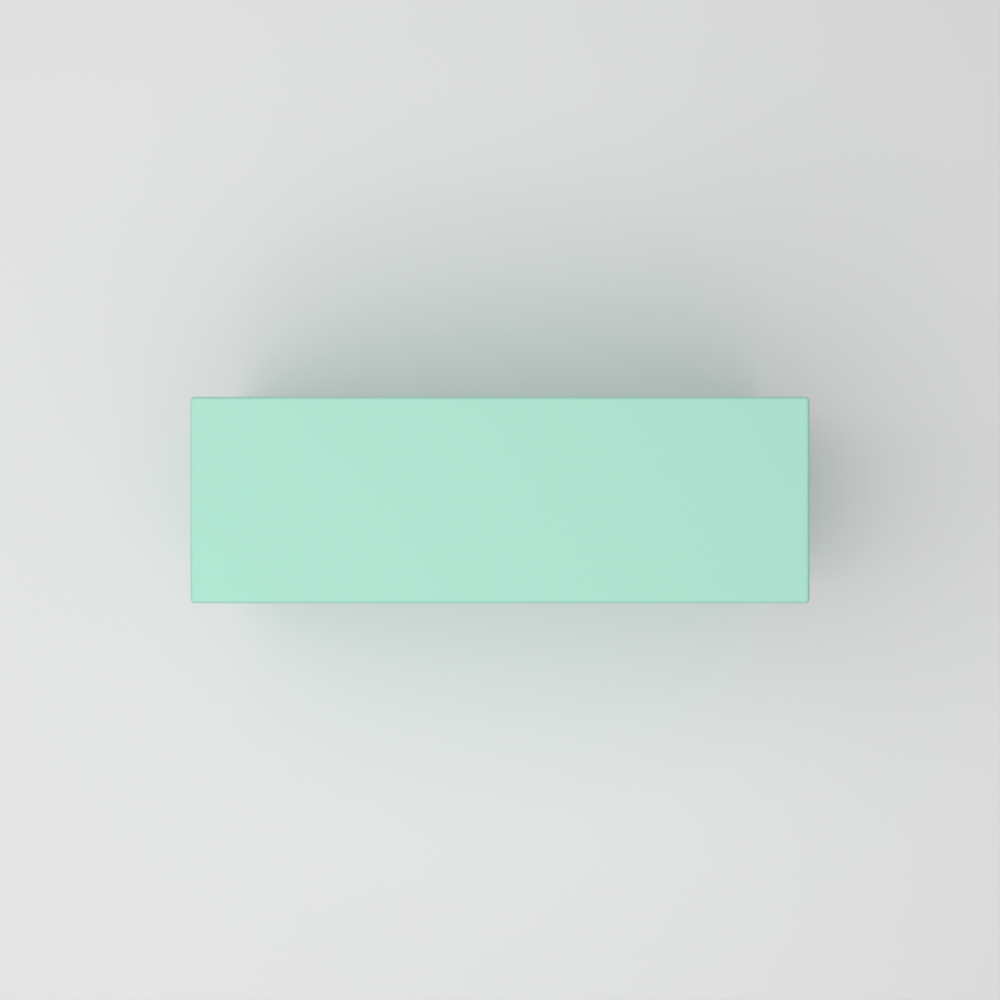

# Prompt-to-Render (v1)

Describe a box product shot in one sentence and get a clean studio render (cosmetics-packaging style). A **local** LLM writes the scene spec, a validator checks it, and Blender renders it on the GPU.

```
python prompt.py "luxury matte red lipstick box, three-quarter view"
```

**Runs fully offline. No API keys, no paid APIs, nothing leaves the machine.** The LLM is [Ollama](https://ollama.com) running `qwen3:8b` on the same laptop GPU that renders.

## How v1 works

```
sentence -> local LLM -> spec -> validator -> Blender -> PNG
```

In more detail:

```
"luxury matte red lipstick box, three-quarter view"
      |
      v
+----------------------+   system prompt: prompts/spec_writer.md
| local LLM            |   + a JSON schema generated from spec.py
| qwen3:8b via Ollama  |   (structured output, thinking off, temperature 0.2)
+----------------------+
      |  JSON: is_box, shape, unsupported[], spec{...}
      v
+----------------------+   invalid? the validator's exact error messages
| spec.py validator    | ----------------------------------------------> back to the LLM
+----------------------+                                                (2 attempts in total)
      |  valid spec          unsupported[] -> printed and logged, never rendered
      v
unload the LLM from GPU memory (Ollama keep_alive 0, checked with nvidia-smi)
      |
      v
+----------------------+
| Blender, Cycles      |   the v0.1 renderer, unchanged
| OptiX on the GPU     |
+----------------------+
      |
      v
runs/<timestamp>_<slug>/   render.png, spec.json, prompt.txt, log.json
```

The design choices that matter:

- **One source of truth for the schema.** Every spec field is declared once, in `spec.FIELDS` (default, allowed values, description). `validate_spec()` checks against that table, and `json_schema()` turns the same table into the JSON schema the LLM must follow. They can't drift apart, and `tests/test_schema.py` checks that every value at the edge of the schema's ranges passes the validator and every value just outside fails.
- **Structured output, then validation anyway.** Ollama's `format` field turns the schema into a grammar that constrains decoding. In practice the grammar enforces the hex pattern, the camera names and the JSON structure. It does **not** enforce number ranges (asked for `roughness: 7.5`, the model wrote 7.5), and the bevel rule (bevel < half the smallest side) can't be written as JSON schema at all. `spec.py` catches both, and that is where the retry loop earns its place.
- **A repair loop with the real error messages.** If validation fails, the model gets its own reply back plus the validator's messages, word for word, and tries once more. After 2 attempts it stops with a clear error.
- **Unsupported requests are never faked.** The renderer draws one box with one colour. Logos, text, patterns and other shapes go into an `unsupported` list that is printed and saved in `log.json`, but never passed to the renderer. A non-box (`"a pink perfume bottle"`) still renders as the closest box, with a clear warning.
- **Shared GPU, one at a time.** `qwen3:8b` takes about 5.5 GB of the 8 GB card. Once the spec is accepted, the model is unloaded and nvidia-smi confirms the memory came back before Blender starts.
- **Measured, not assumed.** 15 eval sentences with range checks, run 3 times each (see [Evals](#evals)).

## Examples (v1)

Each image is the unedited output of `prompt.py`, from the sentence on the left. All rendered on an RTX 5060 Laptop GPU, 1080x1080, about 3 s each.

| Sentence | What the LLM wrote | Render |
|---|---|---|
| `luxury matte red lipstick box, three-quarter view` | 5 x 12 x 3 cm, `#D32F2F`, roughness 0.85, `three_quarter` |  |
| `a high-gloss emerald green perfume box on a pale blush backdrop` | 10 x 20 x 5 cm, `#208040`, roughness 0.1, backdrop `#F8BBD0`, `three_quarter` |  |
| `flat lay of a matte sage green skincare gift box, seen from above` | 15 x 10 x 5 cm, `#B5EAD7`, roughness 0.8, `top_down` |  |

The images also show the model's limits: the lipstick box is bigger than a real one (about 2.5 x 8.5 x 2.5 cm), and "sage" came out closer to mint. See [Known limitations](#known-limitations).

## Setup

| | |
|---|---|
| **Windows 11** | Tested on Windows 11, native (not WSL), Windows PowerShell. |
| **Python 3** | Any recent version. Only the standard library is used, so there's nothing to `pip install` and no venv. |
| **Ollama** | From [ollama.com](https://ollama.com). Then download the model once: `ollama pull qwen3:8b` (about 5 GB). |
| **Blender 5.2** | Expected at `C:\Program Files\Blender Foundation\Blender 5.2\blender.exe`. Other installed versions are found automatically. |
| **NVIDIA RTX GPU** | 8 GB is enough, because the LLM and Blender never hold the GPU at the same time. Without a GPU, Ollama and Blender both fall back to the CPU (much slower). |

## How to run

Make sure Ollama is running (it starts with Windows and sits in the system tray), then:

```
python prompt.py "luxury matte red lipstick box, three-quarter view"
```

Output:

```
Sentence: luxury matte red lipstick box, three-quarter view
Model:    qwen3:8b via Ollama (local, http://127.0.0.1:11434)
Run:      runs\20261018_134310_luxury-matte-red-lipstick-box-three

[llm] attempt 1 of 2: asking qwen3:8b for a spec ...
[llm]   reply in 5.8 s, 2.7 s of it loading the model; 1996 prompt + 141 output tokens
[llm]   valid: spec.py accepted the spec

Spec:
  box        5 x 12 x 3 cm (width x height x depth)
  finish     colour #D32F2F, roughness 0.85, bevel 0.15 cm
  backdrop   #F5F5F5
  camera     three_quarter
  about      A luxury matte red lipstick box in a three-quarter view.

[gpu] unloading qwen3:8b from GPU memory before rendering ...
[gpu] GPU memory: 5831 MiB with the model loaded -> 348 MiB after unloading (5483 MiB freed)

Rendering with C:\Program Files\Blender Foundation\Blender 5.2\blender.exe
[render] device: GPU (OptiX) - NVIDIA GeForce RTX 5060 Laptop GPU
[...]
[render] render time: 3.2 s
[render] colour check: spec #D32F2F, measured #CF2222, Delta E 5.4 (noticeable)

Done.
  Run folder:   runs\20261018_134310_luxury-matte-red-lipstick-box-three
  Image:        runs\20261018_134310_luxury-matte-red-lipstick-box-three\render.png
  LLM:          qwen3:8b, 1 attempt, 5.8 s (incl. 2.7 s loading the model), 1996 prompt + 141 output tokens
  GPU memory:   5831 MiB with the model loaded -> 348 MiB after unloading -> 1521 MiB peak while rendering
  Device:       GPU (OptiX) - NVIDIA GeForce RTX 5060 Laptop GPU
  Render time:  3.2 s (total incl. Blender start-up: 5.5 s)
  Colour check: spec #D32F2F, measured #CF2222, Delta E 5.4 (noticeable)
```

The whole run takes about 15 s: loading the model about 3 s (more on the very first run after a reboot), writing the spec about 2–3 s, then Blender.

Options:

| Option | What it does |
|---|---|
| `--model NAME` | Use another Ollama model, e.g. `--model llama3.1:8b`. Default `qwen3:8b`. |
| `--verbose` | Show the model's raw JSON replies and Blender's full output. |
| `--blender "C:\path\to\blender.exe"` | Use a specific Blender (or set `BLENDER_PATH`). |
| `--break-first-reply` | For testing: corrupt the model's first reply, to watch the repair loop work (see [The repair loop](#the-repair-loop)). |

You can also point it at Ollama on another port or machine with the `OLLAMA_URL` environment variable (default `http://127.0.0.1:11434`). It uses `127.0.0.1` rather than `localhost` on purpose: on Windows, `localhost` tries IPv6 first and added about 2 s to every request.

### What a run saves

Every run gets its own folder, `runs/<timestamp>_<short-slug>/` (ignored by git):

| File | What's in it |
|---|---|
| `prompt.txt` | The sentence. |
| `spec.json` | The validated spec that was rendered. Re-render it any time with `python run.py runs\...\spec.json`. |
| `render.png` | The image. |
| `log.json` | Model and settings, number of attempts, validation errors per attempt, `is_box`, `shape`, the unsupported list, prompt/output token counts (from Ollama's reply), LLM time (and how much of it was loading the model), render time, device, colour check, and GPU memory with the model loaded, after unloading and at peak while rendering. Also every raw model reply. |

### Things it can't draw

The renderer draws exactly one box with one colour. Anything else is listed, not faked:

```
> python prompt.py "a pink perfume bottle with gold logo"
[...]
Spec:
  box        4 x 16 x 2 cm (width x height x depth)
  finish     colour #FFC0CB, roughness 0.4, bevel 0.1 cm
  [...]

========================================================================
WARNING: this is a bottle, but the renderer can only draw a box.
Rendering the closest box instead. Ignored:
  - bottle shape
  - gold logo
========================================================================
[...]
  Not rendered: bottle shape, gold logo
  WARNING:      not a box; the closest box was rendered instead.
```

For a box with a logo, there's no warning banner, just the list (`Not rendered (the renderer can't draw these): - gold logo`). The box keeps its own colour; the logo's gold doesn't leak into it.

The model reports two things here: `is_box` (true/false) and `shape` (e.g. `"bottle"`). When it isn't a box, the code makes sure the shape is the first item in the ignored list. Without this, `qwen3:8b` named the shape in only 2 of 12 dev runs once something else (a logo, a label) was also unsupported. It recorded `is_box: false` correctly in all of them. With the dedicated `shape` field it got 11/12. `log.json` records when the code added the shape (`shape_added_by_code`).

### When Ollama isn't running

```
> python prompt.py "luxury matte red lipstick box, three-quarter view"
Sentence: luxury matte red lipstick box, three-quarter view
Model:    qwen3:8b via Ollama (local, http://127.0.0.1:11434)

Can't reach Ollama at http://127.0.0.1:11434 ([WinError 10061] No connection could be made because the target machine actively refused it).
Ollama doesn't seem to be running. To start it, either:
  - open "Ollama" from the Start menu (it runs in the system tray), or
  - run  ollama serve  in another terminal and leave it open.
Then try again.
Nothing was generated or rendered.
```

A model that isn't installed gets `The model qwen9:404b isn't installed in Ollama. Download it with: ollama pull qwen9:404b`.

## The repair loop

If the spec fails validation, the loop sends the model's reply back to it with the validator's exact messages and asks for a corrected version. It allows 2 attempts in total.

With structured output on, the loop **never fired naturally** in the final eval (0 of 45 runs), because the model's numbers stayed in range. So it is tested two ways:

1. **Offline, with a scripted fake model** (`tests/test_spec_writer.py`). Covers: bad then fixed, bad twice then give up, broken JSON, and that the exact validator messages and the bad reply are what get sent back.
2. **With the real model** (`--break-first-reply`). The model's first reply is corrupted on purpose (roughness 1.4 and a bevel as wide as the box). The validator rejects it, and the real model has to repair it from the real error messages:

```
> python prompt.py "a satin teal tea box, three-quarter view" --break-first-reply
[llm] attempt 1 of 2: asking qwen3:8b for a spec ...
[llm]   reply in 5.7 s, 2.7 s of it loading the model; 1995 prompt + 135 output tokens
[llm]   note: first reply corrupted on purpose (--break-first-reply)
[llm]   reply:
[llm]   | {
[...]
[llm]   |       "roughness": 1.4,
[llm]   |       "bevel_cm": 12
[...]
[llm]   INVALID: spec.py found 2 problem(s):
[llm]     - box.roughness: must be between 0 and 1, got 1.4
[llm]     - box.bevel_cm: must be less than half the smallest box side (4 cm for this box), got 12
[llm] attempt 2 of 2: sending the 2 validation error(s) back to the model ...
[llm]   reply in 2.3 s; 2208 prompt + 133 output tokens
[llm]   valid: spec.py accepted the spec

Spec:
  box        12 x 18 x 8 cm (width x height x depth)
  finish     colour #008080, roughness 0.4, bevel 1.5 cm
```

The model fixed both values and kept everything else. The fixed bevel (1.5 cm) is valid but much rounder than the prompt's usual 0.1–0.4 cm: the model fixes just enough to pass. I tried adding "pick values that follow the rules, not just values that pass" to the fix request. In one test it still chose 1.5 cm, so I dropped the extra wording.

## Evals

```
python evals/run_evals.py                      # 15 cases x 3 runs, specs only (about 2 minutes)
python evals/run_evals.py --render             # also render one spec per case (model unloaded first)
python evals/run_evals.py --model llama3.1:8b  # compare models
python evals/run_evals.py --runs 1 --cases red_lipstick,vague
```

The 15 sentences in `evals/cases.json` go through exactly the same LLM + validation loop as `prompt.py`. Checks run on the final spec and are **ranges, not exact values**: "glossy" means roughness ≤ 0.2, "red" means a hue between 345° and 15°, "tall" means height > 1.5 × width. A run passes only if it produced a valid spec within 2 attempts **and** every check passes. Results go to `evals/results/<timestamp>.json` (every spec, every raw reply, every check) and a Markdown summary beside it.

The eval sentences were written and frozen **before** the system prompt, and none of them (or their products) appear in the prompt as examples. Prompt changes were tried on a separate set of dev sentences.

### Latest results

Model `qwen3:8b` (Ollama, local), 3 runs per case, 2026-10-18 (`evals/results/20261018_133949.json`):

| Case | Sentence | Tests | Passed | Distinct specs |
|---|---|---|---|---|
| `red_lipstick` | a red lipstick box | named colour, realistic size | 3/3 | 2 |
| `navy_serum` | a navy blue serum box | named colour | 3/3 | 1 |
| `hex_exact` | a perfume box in #1B4D3E | exact hex | 3/3 | 1 |
| `hex_glossy` | a glossy box in #F4B6C2 | exact hex, glossy | 3/3 | 2 |
| `glossy_black` | a glossy black perfume box | glossy, named colour | 3/3 | 2 |
| `shiny_gold` | a shiny gold candle box | shiny (= glossy), named colour | 3/3 | 2 |
| `matte_white` | a matte white face cream carton | matte, named colour | 3/3 | 1 |
| `camera_front` | front view of a yellow soap box | camera: front, named colour | 3/3 | 1 |
| `camera_top_down` | overhead shot of a flat blue jewellery box | camera: top_down, flat proportions | 3/3 | 2 |
| `camera_three_quarter` | a purple tea box, three-quarter view | camera: three_quarter, named colour | 3/3 | 1 |
| `tall` | a tall, slim grey box | tall proportions, named colour | 3/3 | 2 |
| `flat` | a flat square box for a silk scarf | flat proportions | 3/3 | 3 |
| `vague` | a nice box | vague prompt | 3/3 | 3 |
| `not_a_box` | a glass perfume bottle | non-box prompt | 3/3 | 3 |
| `logo` | a white matte box with a gold logo on the front | logo request | 3/3 | 1 |

- **Overall:** 45/45 runs passed (100%); 15/15 cases passed every run.
- **Retry loop fired:** 0/45 runs. Still invalid after 2 attempts: 0.
- **Average LLM time:** 2.3 s per run (about 1,990 prompt + 130 output tokens), with the model already loaded.

How to read this honestly:

- **The runs are not very independent.** At temperature 0.2, 6 of the 15 cases gave the identical spec in all 3 runs ("Distinct specs" = 1). So 3 runs measure consistency more than they give three fresh samples.
- **These checks are what this model finds easy.** A perfect score here doesn't mean the specs are good. Some failures no check catches:
  - The lipstick size check (longest side 6–12 cm, shortest 1.5–4 cm) is looser than I meant it to be. It passed `5 x 12 x 2.5`, right at the 12 cm limit, while a real lipstick carton is about `2.5 x 8.5 x 2.5`. It is reported here rather than tightened after the fact.
  - Named colours are mostly CSS keyword colours (`#000080` navy, `#FFD700` gold, `#800080` purple).
  - The backdrop is usually plain `#F5F5F5`, although the prompt asks for a soft tint.
- **`not_a_box` passes partly thanks to code.** In all 3 runs the model set `is_box: false` and `shape: "bottle"`, and the code put "bottle shape" in the unsupported list (see [Things it can't draw](#things-it-cant-draw)). The model's own unsupported list was **empty** in all 3, so "glass" (transparency, which the renderer can't do) was flagged nowhere; the box came out white. The check's keywords ("bottle" or "shape") would accept any non-box shape the model names, so in practice this case now mostly tests `is_box`. Before the `shape` field existed, the model listed "glass perfume bottle" itself in 3/3 runs.
- **One prompt fix was measured on dev sentences.** In the first eval run, 2 of 45 runs chose a `front` camera although the sentence named no angle; no check covered that. (5 of 45 if you count "a gold logo *on the front*", which got `front` in all 3 runs.) On 10 dev sentences with no angle, `front` came up in 6 of 20 runs. After making "three-quarter unless asked" explicit, it was 0 of 20. 14 of 14 dev runs with an explicit front/top-down/angled request still got the right camera. The first eval run (also 45/45, before the fix) is kept in `evals/results/20261018_132659.json`.

## Tests

```
python -m unittest discover tests
```

Offline, no Ollama or Blender needed (27 tests):

- `test_schema.py`: the generated JSON schema and the validator agree on every field (range edges, choices, colour pattern), and the LLM's schema is exactly the spec schema.
- `test_spec_writer.py`: the repair loop with a scripted fake model, and parsing of the model's reply (including the non-box shape rule).
- `test_eval_checks.py`: the eval checks themselves (hue wrapping round red, strict vs inclusive ranges, ...).

---

# The renderer (v0.1)

Everything below is the part that turns a spec into an image. It is unchanged in v1, and still works on its own with hand-written JSON:

```
python run.py specs/pink_three_quarter.json
```

One command builds the whole scene from scratch and saves a PNG to `renders/`. The scene has a bevelled box, a seamless curved backdrop, soft area lights and an auto-framed camera.

## Examples (v0.1)

All three are rendered in `accurate` colour mode, 1080×1080, 128 samples, about 3 seconds each on an RTX 5060 Laptop GPU.


`specs/pink_three_quarter.json`: tall pink matte carton (`#E8A3B5`) on a blush sweep, three-quarter view.


`specs/black_glossy_three_quarter.json`: black glossy box (`#111111`, roughness 0.12) on a warm grey sweep, three-quarter view.


`specs/white_top_down.json`: flat white matte carton (`#F4F3EF`) on sage, seen from directly above.

## Rendering a JSON spec

Open a terminal in this folder and run:

```
python run.py specs/pink_three_quarter.json
python run.py specs/black_glossy_three_quarter.json
python run.py specs/white_top_down.json
```

You'll see something like:

```
Rendering specs/pink_three_quarter.json with C:\Program Files\Blender Foundation\Blender 5.2\blender.exe
[render] device: GPU (OptiX) - NVIDIA GeForce RTX 5060 Laptop GPU
[render] camera: three_quarter, lighting: studio_soft, colour mode: accurate, 1080x1080, 128 samples
[cycles] Path tracing on: NVIDIA GeForce RTX 5060 Laptop GPU (OptiX) [...]
[cycles] Denoising on: NVIDIA GeForce RTX 5060 Laptop GPU (OptiX) [...]
[render] light meter: exposure -0.64 stops (0.3 s)
[render] render time: 3.0 s
[render] saved: C:\Projects\prompt-to-render\renders\pink_three_quarter_20261017_214802.png
[render] colour check: spec #E8A3B5, measured #E29DAF, Delta E 2.2 (small)

Done.
  Spec:         specs/pink_three_quarter.json
  Device:       GPU (OptiX) - NVIDIA GeForce RTX 5060 Laptop GPU
  Cycles:       Path tracing on: NVIDIA GeForce RTX 5060 Laptop GPU (OptiX) [...]
  Cycles:       Denoising on: NVIDIA GeForce RTX 5060 Laptop GPU (OptiX) [...]
  Render time:  3.0 s (total incl. Blender start-up: 5.2 s)
  Colour check: spec #E8A3B5, measured #E29DAF, Delta E 2.2 (small)
  Saved:        renders\pink_three_quarter_20261017_214802.png
```

- The `[cycles] Path tracing on:` line comes from Blender's renderer itself. It shows which device really did the work.
- The colour check line tells you how close the box came out to the colour in your spec (see [Checking colour](#checking-colour)).
- The image is saved as `renders/<spec-name>_<date>_<time>.png`, so earlier renders are never overwritten.

Options:

| Option | What it does |
|---|---|
| `--verbose` | Show all of Blender's output (useful if something goes wrong). |
| `--blender "C:\path\to\blender.exe"` | Use a specific Blender. You can also set the `BLENDER_PATH` environment variable. |

## Make your own shot

Copy one of the files in `specs/`, change the values, and run it. Every field is optional; anything you leave out uses the default.

```json
{
  "description": "Tall pink matte serum carton on a blush backdrop, three-quarter view",
  "box": {
    "width_cm": 5,
    "height_cm": 14,
    "depth_cm": 5,
    "colour": "#E8A3B5",
    "roughness": 0.75,
    "bevel_cm": 0.12
  },
  "background_colour": "#F5DCE1",
  "colour_mode": "accurate",
  "camera": "three_quarter",
  "lighting": "studio_soft",
  "resolution": [1080, 1080],
  "samples": 128
}
```

### Spec fields

These are defined once, in `spec.FIELDS`. The LLM in v1 writes `description`, `box`, `background_colour` and `camera`; the render settings (`colour_mode`, `lighting`, `resolution`, `samples`) keep their defaults.

| Field | Default | Allowed | What it means |
|---|---|---|---|
| `description` | `""` | any text | A note for humans. Not used for rendering. |
| `box.width_cm` | `6` | 0.5 – 200 | Left-to-right size, seen from the front. |
| `box.height_cm` | `12` | 0.5 – 200 | Bottom-to-top size. |
| `box.depth_cm` | `4` | 0.5 – 200 | Front-to-back size. |
| `box.colour` | `"#D9D9D9"` | hex, `"#RRGGBB"` or `"#RGB"` | Box colour. |
| `box.roughness` | `0.5` | 0 – 1 | `0` = mirror-glossy, `1` = fully matte. Glossy packaging ≈ 0.1–0.2, matte card ≈ 0.6–0.8. |
| `box.bevel_cm` | `0.15` | 0 to just under half the smallest side | How rounded the edges are. `0` = razor sharp. Small values (0.1–0.3) look most realistic. |
| `background_colour` | `"#EDEDED"` | hex | Colour of the studio backdrop. |
| `colour_mode` | `"accurate"` | `"accurate"`, `"realistic"` | `accurate`: the box colour matches your hex as closely as possible. `realistic`: filmic AgX look; nice highlights, but colours come out paler. See below. |
| `camera` | `"three_quarter"` | `"front"`, `"three_quarter"`, `"top_down"` | Camera angle (see below). |
| `lighting` | `"studio_soft"` | `"studio_soft"` | Lighting setup. Only one for now. |
| `resolution` | `[1080, 1080]` | each side 16 – 8192 | Image size in pixels, `[width, height]`. Non-square works too. |
| `samples` | `128` | 1 – 8192 | Render quality. More is cleaner but slower. 128 is plenty with the denoiser on. |

Size units are centimetres and the box always stands on the floor. The camera reframes itself for any size, so a lipstick box and a gift box both fill the frame the same way.

### Colour modes

**`accurate`** (default) is for when the brand colour matters.
- **View transform:** Blender's *Khronos PBR Neutral*, which was designed for product images. Colours up to about 80% brightness come out nearly unchanged; it subtracts a small amount to cancel surface sheen, so matte colours can come out very slightly darker. Brighter highlights are gently compressed instead of clipping to flat white.
- **Exposure:** set by a **light meter**. Before the real render, the box is briefly made pure matte white and a tiny patch at the centre of its main lit face is rendered (about 0.3 s). This is like a photographer holding a white card where the product is. Exposure is set so that card reads exactly 100%, which makes a matte box show its own colour.
- **White balance:** the same card also sets it. Light bouncing off a coloured backdrop would otherwise tint the box. To counter that, all lights get a slight opposite tint.
- **What it matches:** only the box colour is matched. The backdrop is lit more brightly than the box, so it usually comes out a bit lighter than its hex.

**`realistic`** is the filmic look.
- It uses AgX with the "Medium High Contrast" look. Light and shadow look more film-like, but colours shift: pastels come out noticeably paler, and blacks come out grey.
- Exposure is fixed rather than metered.

Measured colour of the box (see [Checking colour](#checking-colour)). Delta E is the colour difference: under 2 is hard to see, 2–5 small, 5–10 noticeable, over 10 obvious.

| Example | Spec hex | `accurate` measured | ΔE | `realistic` measured | ΔE |
|---|---|---|---|---|---|
| Pink matte | `#E8A3B5` | `#E29DAF` | 2.2 | `#DEBEC5` | 16.6 |
| Black glossy | `#111111` | `#242220` | 8.5 | `#474542` | 24.4 |
| White matte | `#F4F3EF` | `#EBEAE7` | 3.2 | `#D5D5D3` | 10.6 |

A glossy black box can never measure exactly `#111111`. Its shiny surface reflects the bright studio around it, just as it would in a real photo.

### Camera presets

| Preset | Angle |
|---|---|
| `front` | Straight on, from just above the box's middle (8° up). |
| `three_quarter` | 35° to the right and 22° up: the classic packshot showing the front, right side and top. |
| `top_down` | Directly overhead (flat lay). The front of the box is at the bottom of the image. |

The backdrop sweep is always turned to face the camera, like in a real studio, so the camera looks straight into the curve.

### Lighting preset: `studio_soft`

Soft area lights (softboxes), placed relative to the camera so every angle gets the same look:

- **Key**: front-left and above. The main light; sets the shadow direction.
- **Fill**: low, straight in front. Softens shadows. On glossy boxes it also shows up as a softbox reflection on the front face.
- **Rim**: behind the box on the opposite side. Lights the top and back edges so the box separates from the backdrop.
- **Backdrop**: a big softbox behind the box, aimed away from it at the sweep. It lights the far backdrop evenly so it doesn't fall off into dark corners.

For `top_down` the setup changes. From straight above, a rim light only adds a second shadow that crosses the first, and the backdrop light's edge would land in the frame. So top-down uses only the key and fill: a higher, larger key for a short soft shadow, and the fill moved overhead to lighten that shadow.

The lights themselves are invisible to the camera; you only see their light and their reflections.

## Checking colour

`check_colour.py` measures how close a render's box colour is to its spec:

```
> python check_colour.py specs/pink_three_quarter.json renders/pink_three_quarter_20261017_214802.png
Spec:          C:\Projects\prompt-to-render\specs\pink_three_quarter.json
Image:         C:\Projects\prompt-to-render\renders\pink_three_quarter_20261017_214802.png
Patch:         centre of the front face, 37x51 px
Spec colour:   #E8A3B5
Measured:      #E29DAF
Delta E (76):  2.2  (small)
```

It rebuilds the scene from the spec to find exactly where the centre of the box's main lit face is in the image. That's the front face for `front` and `three_quarter`, and the top face for `top_down`. It then averages the pixels in a small patch there and compares them with the spec colour using CIE76 Delta E. It runs Blender in the background for you; nothing extra to install.

`run.py` and `prompt.py` already run the same check after every render (the `colour check` line), so you only need this script to re-check an existing image.

Note: in `accurate` mode the light meter and the colour check use the same patch. So the *brightness* of a matte box matches largely by design. The Delta E still catches everything else: wrong hue or saturation, reflections on glossy boxes, and the view transform's effect on colour.

## When a spec is wrong

The spec is checked **before** Blender starts. Every problem is listed in plain English and nothing is rendered:

```
> python run.py tests/broken_colour.json
Spec error in tests/broken_colour.json:
  - box.colour: must be a hex colour like "#F4B6C2", got "pinkish"
Nothing was rendered. Fix the spec and try again.

> python run.py tests/broken_colour_mode.json
Spec error in tests/broken_colour_mode.json:
  - colour_mode: must be one of "accurate", "realistic", got "vivid"
Nothing was rendered. Fix the spec and try again.
```

The checks also catch:
- numbers out of range;
- text where a number should be;
- unknown camera names;
- bevels too big for the box;
- broken JSON (with the line and column);
- misspelled field names, with a suggestion such as `box.color: unknown field. Did you mean "box.colour"?`.

These are the same messages the LLM receives in v1 when its spec fails.

## GPU vs CPU

`render_scene.py` forces Cycles onto the GPU itself, so it doesn't depend on the settings saved in Blender's UI (headless runs don't reliably use them). It:

1. sets the Cycles compute device to **OptiX** and enables only the RTX GPU (not the CPU, which would make a slower hybrid render);
2. uses the **OptiX denoiser**;
3. if no OptiX GPU is found, falls back to the **CPU** with the OpenImageDenoise denoiser. It also prints a loud `WARNING` banner, and repeats the warning in the final summary.

On an RTX 5060 Laptop GPU a 1080×1080, 128-sample render takes about 3 seconds, plus 0.3 s for the light meter in `accurate` mode. The same render on the CPU took about 24 seconds.

## How it works

| File | Job |
|---|---|
| `prompt.py` | **v1 entry point.** Sentence in, render out: LLM + validation loop, unload the model, render, save the run folder. |
| `llm_backend.py` | The only code that talks to an LLM. Builds the system prompt and the JSON schema, and implements Ollama over its REST API (standard-library `urllib`). A new backend (e.g. a hosted API) only has to implement `_chat(messages, schema)`, `release()` and `check()`. |
| `spec_writer.py` | The validation loop: parse the model's reply, validate the spec, send errors back, 2 attempts max. Shared by `prompt.py` and the evals. |
| `prompts/spec_writer.md` | The system prompt: what the renderer can do, and the rules (sizes, colours, finish, camera, unsupported, non-box). |
| `gpu.py` | GPU memory readings from nvidia-smi. |
| `run.py` | Renders a JSON spec. Checks the spec, finds Blender, starts it in the background, shows the important lines, saves the PNG, prints the timing and colour check. |
| `spec.py` | The spec's single source of truth: fields, defaults, validation, and the JSON schema. Used by everything, including Blender. |
| `render_scene.py` | Runs inside Blender. Builds the box, backdrop, lights, world and camera from scratch, runs the light meter (`accurate` mode), renders, checks the colour. |
| `check_colour.py` | Measures the box colour in a render against the spec (spec hex, measured hex, Delta E). |
| `evals/` | `cases.json` (15 eval sentences and their checks), `run_evals.py`, and `results/`. |
| `tests/` | Unit tests (`python -m unittest discover tests`) and deliberately broken specs. |
| `specs/` | Example hand-written specs. |
| `docs/` | The example images shown above. |
| `runs/`, `renders/` | Output (ignored by git). |

Scene details:

- **Box**: a mesh with a Bevel modifier. "Harden normals" keeps the big faces perfectly flat, so glossy reflections don't smear. The material is a Principled BSDF with your colour and roughness.
- **Backdrop**: a floor that curves smoothly up into a back wall, meeting both tangentially, so there is no horizon line. It is turned to face the camera.
- **Camera**: an 85 mm lens. The distance is solved so the box fills about 62% of the frame on its tightest side. The lens is shifted so the box sits dead centre.
- **Colour**: hex colours are converted from sRGB to Blender's linear colour space. The view transform depends on `colour_mode` (see above).

LLM details:

- **Structured output:** the schema goes in Ollama's `format` field, and also into the system prompt, as Ollama's docs recommend.
- **Thinking off:** `qwen3` thinks out loud by default. The request sets `"think": false` (only for models that support thinking), and any stray `<think>` block would be stripped before parsing.
- **Settings:** temperature 0.2, context 4096 tokens, at most 512 output tokens. Ollama silently cuts the start off a prompt that doesn't fit its context, which would remove the system prompt. So the context size is set explicitly, and every reply is checked: a prompt that used more than 4096 − 512 tokens is an error. The prompt is about 2,000 tokens; a retry about 2,200.
- **Unloading:** `keep_alive: 0`, then wait until Ollama's `/api/ps` no longer lists the model, then wait until nvidia-smi shows the memory back. It also unloads when the spec is invalid, on errors and on Ctrl-C.

You can also run the Blender part directly:

```
"C:\Program Files\Blender Foundation\Blender 5.2\blender.exe" --background --factory-startup --python render_scene.py -- --spec specs/pink_three_quarter.json --output renders/test.png
```

## Known limitations

- **One box, one colour.** No logos, text, patterns, other shapes, materials or props. These are reported, never faked.
- **An 8B model's taste.** The specs are valid and follow the main rules, but colours are often plain CSS colours, sizes can be off for small products (lipstick), backdrops are usually plain off-white, and round objects become boxes with the wrong depth (the perfume bottle came out 4 x 16 x **2** cm instead of square).
- **Materials aren't reliably flagged.** "Glass" in "a glass perfume bottle" wasn't listed as unsupported (see the eval notes); the box was simply white.
- **Repairs pass, but can be off-style** (see [The repair loop](#the-repair-loop)).
- **Cold start.** The first run after a reboot loads about 5 GB from disk. Later runs load in about 3 s, because the model is unloaded after every run to free the GPU for Blender.

## Troubleshooting

- **"Can't reach Ollama"**: start Ollama from the Start menu, or run `ollama serve` in another terminal.
- **"The model ... isn't installed"**: `ollama pull qwen3:8b`.
- **"Could not find blender.exe"**: pass `--blender "C:\path\to\blender.exe"` or set `BLENDER_PATH`.
- **The WARNING banner says it rendered on the CPU**: update the NVIDIA driver. In Blender, check *Edit → Preferences → System → Cycles Render Devices → OptiX* lists the RTX GPU.
- **"RENDER FAILED"**: run again with `--verbose` to see Blender's full output.

## Roadmap

- **v0**: JSON spec → studio render of a box.
- **v0.1**: colour modes with a measured colour check, cleaner studio sweeps, softer top-down lighting.
- **v1 (this)**: a local LLM (Ollama, `qwen3:8b`) turns a sentence into the spec, with a schema generated from the validator, a repair loop, GPU hand-off and evals. Fully offline.
- **Next**: harder eval cases (conflicting instructions, named backdrops, sizes of small products), a second backend behind `llm_backend.py`, and comparing models with `--model`.
