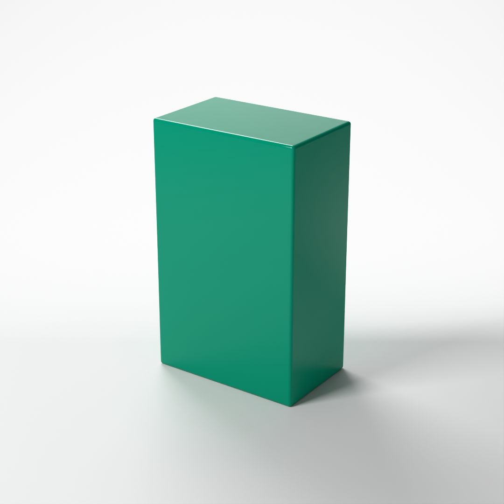
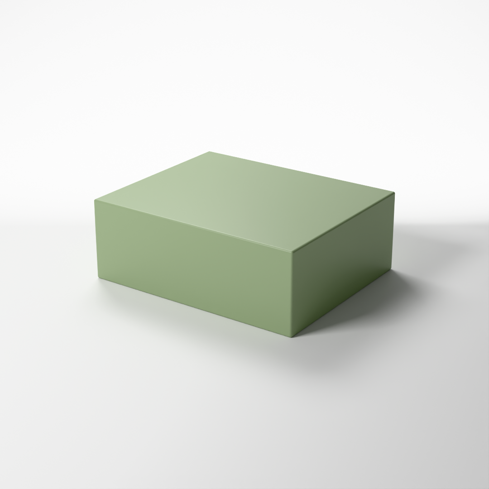
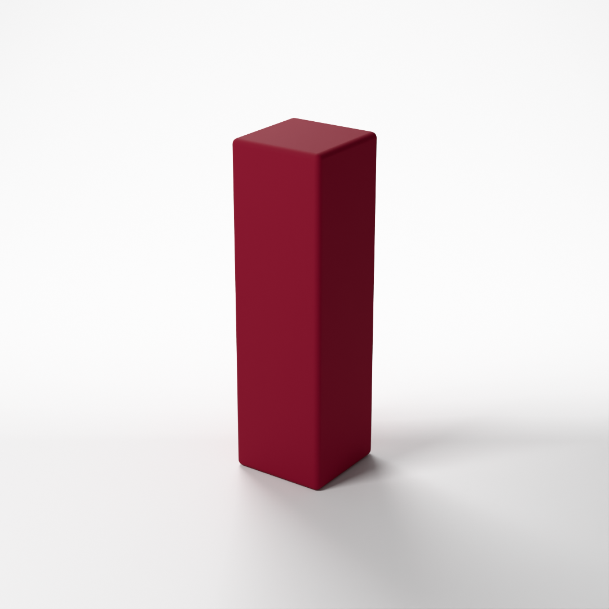

# Prompt-to-Render

[](https://github.com/UditBuilds/prompt-to-render/actions/workflows/tests.yml)

Type a sentence, get a studio product render — fully offline, local 8B model + Blender.

| "a glossy emerald perfume box" | "a sage green gift box" | "luxury matte red lipstick box, three-quarter view" |
|---|---|---|
|  |  |  |
| v1.3 | v1.3 | v1.2 (v1.3's came out a warmer brick red) |

No API keys, no cloud calls: the model (`qwen3:8b` via [Ollama](https://ollama.com)) and Blender share one 8 GB laptop GPU.

## How it works

```
sentence → local LLM → spec → validator → code rules → Blender → PNG
           qwen3:8b    JSON   spec.py     style words, Cycles,
           + rows from        (on error,  gloss,       on the GPU
           small lookup       retry once) backdrop
           tables
```

The model decides what the sentence means; code does the arithmetic. Anything the renderer can't draw (logos, bottles, text) is listed in a warning, never faked.

## Results

37 eval sentences × 3 runs each, every version scored on the same checks. **In-table**: colour names that are in the lookup table (10 sentences). **Out-of-table**: rust, ochre, fuchsia, periwinkle and sapphire, kept out of the table on purpose so they measure the model's own colour knowledge (5 sentences).

| Version | What changed | All checks passed | In-table colour right | Out-of-table colour right |
|---|---|---|---|---|
| v1 | local LLM writes the spec | 66/111 (59%) | 13/30 (43%) | 6/15 (40%) |
| v1.1 | lookup tables for colours, sizes, style words | 73/111 (66%) | 18/30 (60%) | 0/15 (0%) |
| v1.2 | new emerald and sage hexes; gloss and backdrop set by code | 94/111 (85%) | 30/30 (100%) | 0/15 (0%) |
| v1.3 | example hex removed from the schema, prompt cleaned | 105/111 (95%) | 30/30 (100%) | 9/15 (60%) |

v1.3 includes one fix to the colour check made after its run: H/S/L are rounded to 6 decimals, so ochre `#CC9966` (lightness exactly 60%, on the range's edge) passes. Saved results were re-scored, not re-run; nothing else changed. Per case: [`evals/results/comparison_v1.3.md`](evals/results/comparison_v1.3.md).

## What I learned

- **Lookup tables raised in-table accuracy, but the model began copying.** In-table colours went from 43% (no tables) to 100%, but the model copies the table's hex character for character. That score measures the lookup, not the model.
- **The out-of-table score dropped to 0, and the cause was found.** Asked for fuchsia, the model returned `#E8A3B5`: the example hex in the schema. With the example replaced by `"#RRGGBB"` and stale prompt lines removed, the score came back to 9/15.

|  |  |
|---|---|
| v1.2: model copied the schema's example hex (#E8A3B5) | v1.3: example removed → real fuchsia (#E100FF) |

Both images were re-rendered from the saved v1.2 and v1.3 eval specs for "a fuchsia nail polish box", not new model runs; only the colour differs.

- **Rules a small model can't follow reliably moved into code.** Style words ("luxury" = darker), glossy finishes and neutral backdrops are now set by code after the model, and logged. In v1.2 and v1.3 the model wrote a roughness of 0.1–0.3 in all 15 glossy and shiny runs (glossy needs ≤ 0.05); code clamps it to 0.05.
- **Evals were written before the fixes.** From v1.1 on, each version's eval sentences and checks were committed before any of its changes, and tuning used a separate dev set, so the fixes couldn't be fitted to the test. When a check itself was corrected (the backdrop test, the ochre rounding), every saved result was re-scored, so all versions are compared on the same checks.

## Known limitations

- **Unfamiliar colour names fall back to nearby, often CSS, colours.** Periwinkle comes out a lavender (`#B59FC3`), sapphire comes out CSS cornflower blue (`#6495ED`, too light).
- **Glossy looks satin.** Roughness is clamped to at most 0.05, but the soft studio light has nothing sharp to reflect.
- **Boxes only.** One box, one colour. Other shapes render as the closest box, with a warning.
- **No logos or text.** They are listed as unsupported, not drawn.
- **Small local model.** An 8B model knows fewer colours than a large one; the code supports others through `--model`.

## Next (v2)

- **More shapes:** cylinder, bottle and jar, not just boxes.
- **Glossy studio lighting:** sharper lights for glossy finishes to reflect.
- **Colours as HSL instead of hex:** hue, saturation and lightness in the spec, in place of a hex code.
- **Logo and label text:** drawn on the packaging, instead of listed as unsupported.

## How to run

Windows 11, PowerShell. Needs Python 3 (standard library only, nothing to `pip install`), [Ollama](https://ollama.com), Blender 5.2 and an NVIDIA RTX GPU (it falls back to the CPU, much slower).

```powershell
ollama pull qwen3:8b                 # once, about 5 GB
python prompt.py "luxury matte red lipstick box, three-quarter view"
```

The image is saved to `runs\<timestamp>_<short-name>\render.png`, with the spec and a full log beside it.

Blender is expected at `C:\Program Files\Blender Foundation\Blender 5.2\blender.exe` (other installed versions are found automatically). If it's elsewhere:

```powershell
$env:BLENDER_PATH = "D:\Apps\Blender\blender.exe"
# or: python prompt.py "a sage green gift box" --blender "D:\Apps\Blender\blender.exe"
```

Tests (offline, no Ollama or Blender): `python -m unittest discover tests`. Evals (needs Ollama, about 4.5 minutes): `python evals/run_evals.py`.

The full write-up, with every version, eval and design decision, is in [`docs/details.md`](docs/details.md).
