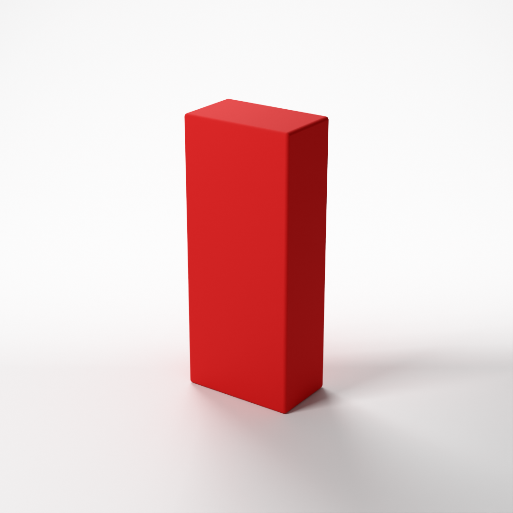
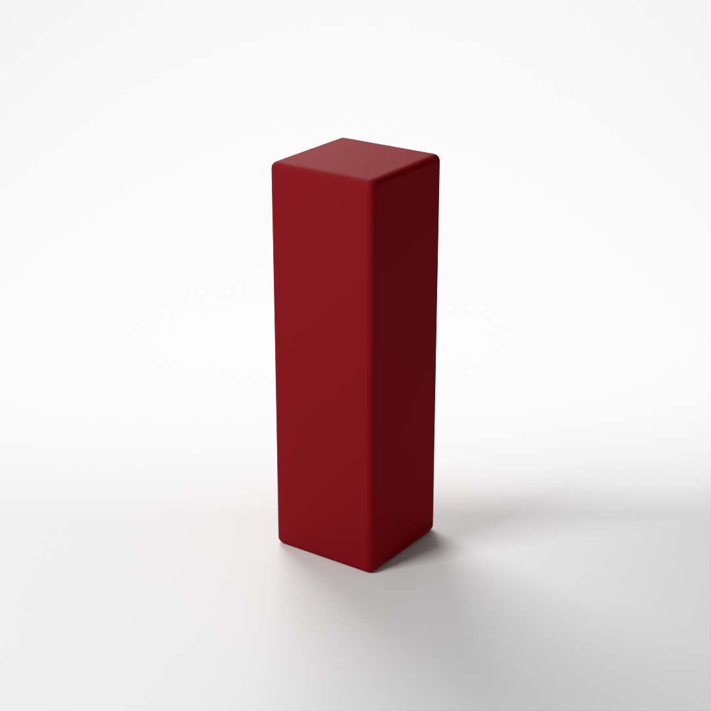
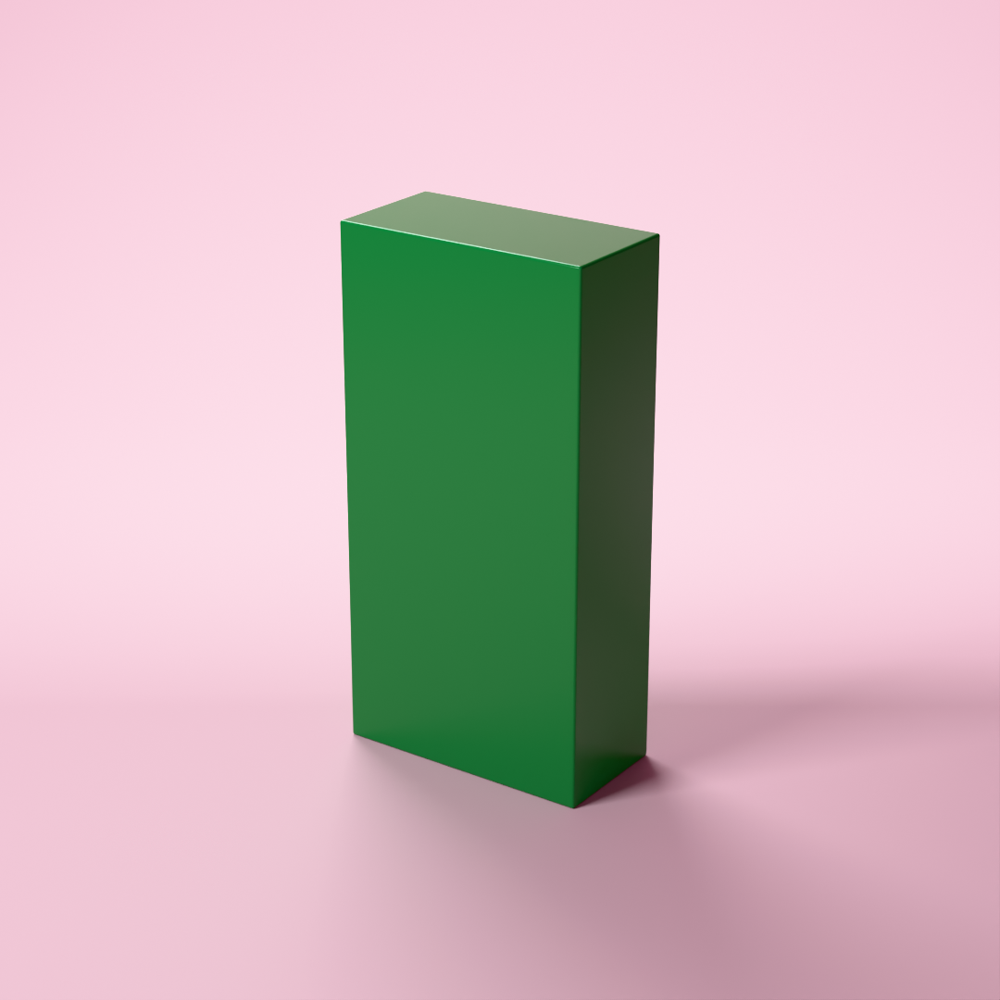
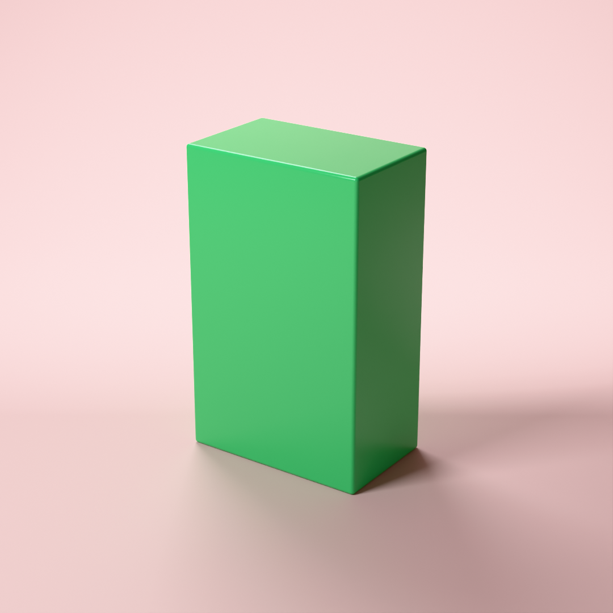
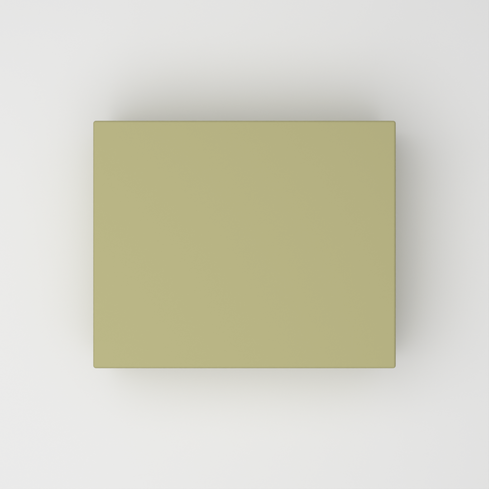
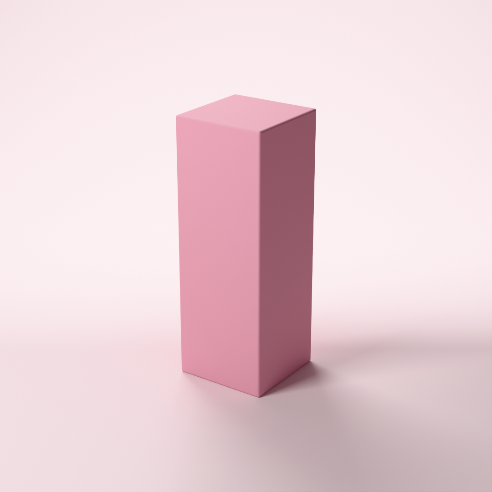
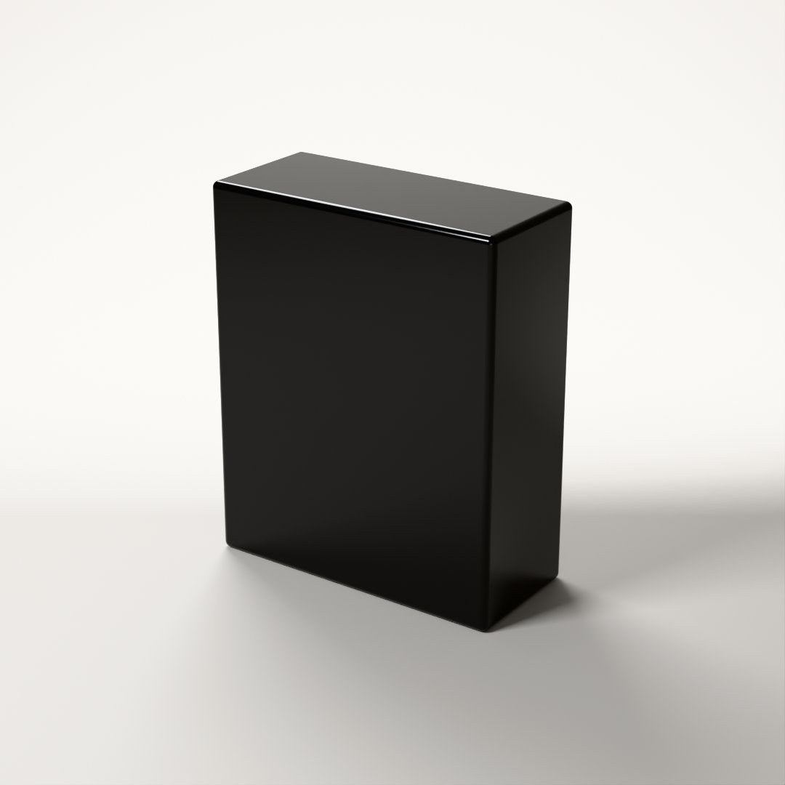
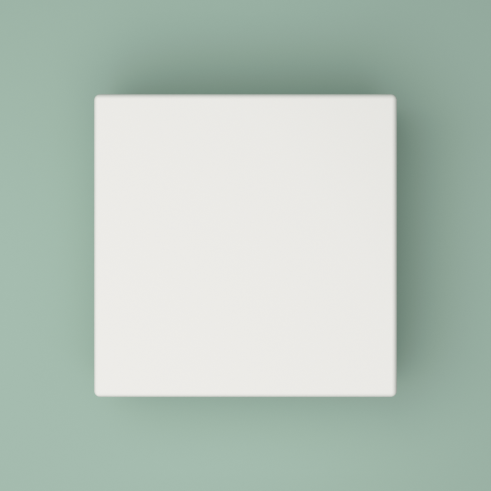

# Prompt-to-Render (v1.1)

Describe a box product shot in one sentence and get a clean studio render (cosmetics-packaging style). A **local** LLM writes the scene spec, grounded by small reference tables; a validator checks it; Blender renders it on the GPU.

```
python prompt.py "luxury matte red lipstick box, three-quarter view"
```

**Runs fully offline. No API keys, no paid APIs, nothing leaves the machine.** The LLM is [Ollama](https://ollama.com) running `qwen3:8b` on the same laptop GPU that renders.

| v1 (no tables) | v1.1 (grounded) |
|---|---|
|  |  |

## The pipeline

```
sentence -> table lookup -> local LLM -> spec -> validator -> Blender -> PNG
```

In more detail:

```
"luxury matte red lipstick box, three-quarter view"
      |
      v
+----------------------+   whole-word lookup in data/: colours, product sizes, style words
| grounding.py         |   -> only the matching rows, e.g. "lipstick: typically 2.5 x 8.5 x 2.5 cm",
+----------------------+      "luxury: deeper and richer"   (nothing matched -> nothing added)
      |
      v
+----------------------+   system prompt: prompts/spec_writer.md
| local LLM            |   + a JSON schema generated from spec.py
| qwen3:8b via Ollama  |   + the sentence and its table rows
+----------------------+   (structured output, thinking off, temperature 0.2)
      |  JSON: is_box, shape, unsupported[], spec{...}
      v
+----------------------+   invalid? the validator's exact error messages
| spec.py validator    | ----------------------------------------------> back to the LLM
+----------------------+                                                (2 attempts in total)
      |  valid spec          unsupported[] -> printed and logged, never rendered
      v
style words shift the box colour (code, from data/style_words.json)
      |
      v
unload the LLM from GPU memory (Ollama keep_alive 0, checked with nvidia-smi)
      |
      v
+----------------------+
| Blender, Cycles      |   the v0.1 renderer, unchanged
| OptiX on the GPU     |
+----------------------+
      |
      v
runs/<timestamp>_<slug>/   render.png, spec.json, prompt.txt, log.json
```

The design choices that matter:

- **One source of truth for the schema.** Every spec field is declared once, in `spec.FIELDS` (default, allowed values, description). `validate_spec()` checks against that table, and `json_schema()` turns the same table into the JSON schema the LLM must follow. They can't drift apart, and `tests/test_schema.py` checks that every value at the edge of the schema's ranges passes the validator and every value just outside fails.
- **Structured output, then validation anyway.** Ollama's `format` field turns the schema into a grammar that constrains decoding. In practice the grammar enforces the hex pattern, the camera names and the JSON structure. It does **not** enforce number ranges (asked for `roughness: 7.5`, the model wrote 7.5), and one rule can't be written as JSON schema at all: the bevel may be at most 10% of the box's smallest side. `spec.py` catches those, and that is where the retry loop earns its place.
- **A repair loop with the real error messages.** If validation fails, the model gets its own reply back plus the validator's messages, word for word, and tries once more. After 2 attempts it stops with a clear error.
- **Grounding with small tables, not a bigger prompt.** The words of the sentence are looked up in three small tables in `data/`, and only the matching rows are added to the request (see [Grounding](#grounding)). This took the eval from 76% to 100% of runs; prompt edits alone didn't move it.
- **Unsupported requests are never faked.** The renderer draws one box with one colour. Logos, text, patterns, materials and other shapes go into an `unsupported` list that is printed and saved in `log.json`, but never passed to the renderer. A non-box (`"a pink perfume bottle"`) still renders as the closest box, with a clear warning.
- **The model judges, the code does arithmetic.** Two things an 8B model got wrong reliably are done in code from what the model decides: listing a non-box's shape (from its `shape` field), and shifting a colour for a style word like "luxury" (from `data/style_words.json`). Both are logged, and both are counted separately in the evals.
- **Shared GPU, one at a time.** `qwen3:8b` takes about 5.5 GB of the 8 GB card. Once the spec is accepted, the model is unloaded and nvidia-smi confirms the memory came back before Blender starts.
- **Measured, not assumed.** 30 frozen eval sentences with range checks, run 3 times each, before and after grounding (see [Evals](#evals)).

## Setup

| | |
|---|---|
| **Windows 11** | Tested on Windows 11, native (not WSL), Windows PowerShell. |
| **Python 3** | Any recent version. Only the standard library is used, so there's nothing to `pip install` and no venv. |
| **Ollama** | From [ollama.com](https://ollama.com). Then download the model once: `ollama pull qwen3:8b` (about 5 GB). |
| **Blender 5.2** | Expected at `C:\Program Files\Blender Foundation\Blender 5.2\blender.exe`. Other installed versions are found automatically. |
| **NVIDIA RTX GPU** | 8 GB is enough, because the LLM and Blender never hold the GPU at the same time. Without a GPU, Ollama and Blender both fall back to the CPU (much slower). |

## How to run

Make sure Ollama is running (it starts with Windows and sits in the system tray), then:

```
python prompt.py "luxury matte red lipstick box, three-quarter view"
```

Output:

```
Sentence: luxury matte red lipstick box, three-quarter view
Model:    qwen3:8b via Ollama (local, http://127.0.0.1:11434)
Run:      runs\20261018_145027_luxury-matte-red-lipstick-box-three

[grounding] table rows for this sentence: style luxury, product lipstick
[llm] attempt 1 of 2: asking qwen3:8b for a spec ...
[llm]   reply in 5.9 s, 2.7 s of it loading the model; 2445 prompt + 138 output tokens
[llm]   valid: spec.py accepted the spec
[grounding] style "luxury" applied to the box colour: #C51E2A -> #841B22

Spec:
  box        2.5 x 8.5 x 2.5 cm (width x height x depth)
  finish     colour #841B22, roughness 0.8, bevel 0.15 cm
  backdrop   #F5F5F5
  camera     three_quarter
  about      Luxury matte red lipstick box, three-quarter view

[gpu] unloading qwen3:8b from GPU memory before rendering ...
[gpu] GPU memory: 5826 MiB with the model loaded -> 341 MiB after unloading (5485 MiB freed)

Rendering with C:\Program Files\Blender Foundation\Blender 5.2\blender.exe
[render] device: GPU (OptiX) - NVIDIA GeForce RTX 5060 Laptop GPU
[...]
[render] render time: 3.1 s
[render] colour check: spec #841B22, measured #82171E, Delta E 1.7 (hard to see)

Done.
  Run folder:   runs\20261018_145027_luxury-matte-red-lipstick-box-three
  Image:        runs\20261018_145027_luxury-matte-red-lipstick-box-three\render.png
  LLM:          qwen3:8b, 1 attempt, 5.9 s (incl. 2.7 s loading the model), 2445 prompt + 138 output tokens
  GPU memory:   5826 MiB with the model loaded -> 341 MiB after unloading -> 1172 MiB peak while rendering
  Device:       GPU (OptiX) - NVIDIA GeForce RTX 5060 Laptop GPU
  Render time:  3.1 s (total incl. Blender start-up: 5.6 s)
  Colour check: spec #841B22, measured #82171E, Delta E 1.7 (hard to see)
```

The whole run takes about 15 s: loading the model about 3 s (more on the very first run after a reboot), writing the spec about 2–3 s, then Blender.

Options:

| Option | What it does |
|---|---|
| `--model NAME` | Use another Ollama model, e.g. `--model llama3.1:8b`. Default `qwen3:8b`. |
| `--no-grounding` | Don't add the table rows; the model decides everything on its own. |
| `--verbose` | Show the table rows sent, the model's raw JSON replies and Blender's full output. |
| `--blender "C:\path\to\blender.exe"` | Use a specific Blender (or set `BLENDER_PATH`). |
| `--break-first-reply` | For testing: corrupt the model's first reply, to watch the repair loop work (see [The repair loop](#the-repair-loop)). |

You can also point it at Ollama on another port or machine with the `OLLAMA_URL` environment variable (default `http://127.0.0.1:11434`). It uses `127.0.0.1` rather than `localhost` on purpose: on Windows, `localhost` tries IPv6 first and added about 2 s to every request.

### What a run saves

Every run gets its own folder, `runs/<timestamp>_<short-slug>/` (ignored by git):

| File | What's in it |
|---|---|
| `prompt.txt` | The sentence. |
| `spec.json` | The validated spec that was rendered. Re-render it any time with `python run.py runs\...\spec.json`. |
| `render.png` | The image. |
| `log.json` | Model and settings; whether grounding was on and **which table rows were used** (`grounding_rows`); any style colour shift (`style_changes`); number of attempts and validation errors per attempt; `is_box`, `shape`; the unsupported list, and the model's own list before the code added anything (`model_unsupported`); prompt/output token counts (from Ollama's reply); LLM time (and how much of it was loading the model); render time; device; colour check; GPU memory with the model loaded, after unloading and at peak while rendering. Also every raw model reply. |

### Things it can't draw

The renderer draws exactly one box with one colour. Anything else is listed, not faked:

```
> python prompt.py "a pink perfume bottle with gold logo"
[grounding] table rows for this sentence: product perfume, colour gold #D4AF37
[...]
Spec:
  box        7.5 x 13.5 x 5 cm (width x height x depth)
  finish     colour #FFC0CB, roughness 0.4, bevel 0.15 cm
  [...]

========================================================================
WARNING: this is a bottle, but the renderer can only draw a box.
Rendering the closest box instead. Ignored:
  - bottle shape
  - gold logo
========================================================================
[...]
  Not rendered: bottle shape, gold logo
  WARNING:      not a box; the closest box was rendered instead.
```

The gold row was retrieved because "gold" is in the sentence, but it describes the logo, so the box stays pink: colour rows are given to the model as a glossary ("use it for whatever the sentence uses that name for"), not as the box colour.

The model reports `is_box` and `shape` (e.g. `"bottle"`). When it isn't a box, the code makes sure the shape is the first item in the ignored list: without that, `qwen3:8b` named the shape in only 2 of 12 dev runs once something else (a logo, a label) was also unsupported. `log.json` records when the code added it (`shape_added_by_code`), and the evals only count the model's own list.

### When Ollama isn't running

```
> python prompt.py "luxury matte red lipstick box, three-quarter view"
Sentence: luxury matte red lipstick box, three-quarter view
Model:    qwen3:8b via Ollama (local, http://127.0.0.1:11434)

Can't reach Ollama at http://127.0.0.1:11434 ([WinError 10061] No connection could be made because the target machine actively refused it).
Ollama doesn't seem to be running. To start it, either:
  - open "Ollama" from the Start menu (it runs in the system tray), or
  - run  ollama serve  in another terminal and leave it open.
Then try again.
Nothing was generated or rendered.
```

A model that isn't installed gets `The model qwen9:404b isn't installed in Ollama. Download it with: ollama pull qwen9:404b`.

## Grounding

**The problem.** The v1 renders worked, but the model picked bad values: "emerald" became plain web green, "sage" became mint, the luxury red was a fire-engine red no deeper than a plain red, the lipstick box was twice as wide as a real one, and the gift box was a 3:1 slab. A small model knows roughly what these words mean, but not precisely, and not consistently.

**The fix: three small tables, retrieved per sentence.**

| Table | Rows | What a row says |
|---|---|---|
| `data/colours.json` | 44 specific colour names common in cosmetics and packaging (emerald, sage, wine, blush, champagne, rose gold, nude, charcoal, ...) | the hex, from CSS or Wikipedia |
| `data/product_sizes.json` | 17 products (lipstick, perfume, serum, gift box, eyeshadow palette, lash box, candle, ...) | typical box size and ranges in cm |
| `data/style_words.json` | 5 styles (luxury, minimal, playful, natural, bold, with synonyms) | a colour shift (lightness, saturation) and a finish |

`grounding.py` matches the sentence against every name and alias: whole words, case-insensitive, longest phrase first, each word used once ("rose gold" isn't also gold; "face cream" is a product, not the colour cream). Only the matching rows are added after the sentence in the user message, at most 4 colours, 2 products and 2 styles, so the system prompt stays the same for every sentence. A style word inside a backdrop phrase ("on a playful pink backdrop") describes the backdrop, not the box, so it is left out, and very common words (clean, simple, fun, kids) are not style aliases. A word that isn't in the tables is left to the model; a sentence with no match ("a nice box") gets nothing added. Basic colour words (red, blue, green, ...) are deliberately not in the colour table: the model handles them well, and a fixed hex would flatten style words.

For "luxury matte red lipstick box, three-quarter view", the model receives:

```
luxury matte red lipstick box, three-quarter view

Reference data for words in this sentence (from Prompt-to-Render's tables):
Product sizes: the usual box for that product, width x height x depth in cm.
- lipstick: typically 2.5 x 8.5 x 2.5; width 2-3, height 7.5-9.5, depth 2-3
Style words: choose the plain box colour as usual (don't shift it yourself); the colour shift is applied to it automatically afterwards. Do apply the finish.
- "luxury": colour becomes deeper and richer (30% darker, 10% less saturated, applied for you). Finish: matte 0.7-0.85, or high-gloss 0.03-0.08 if gloss is asked for; avoid the in-between.
Use these values. Anything not listed here is up to you.
```

**Why the style shift is code.** On the dev sentences, `qwen3:8b` couldn't apply a style word to a colour itself. When the style table had example hex values, it copied the example verbatim ("a playful orange box" got the example's `#FF8C42`, darker than its own plain orange). Without examples, it didn't shift at all ("a luxury teal box" came back exactly teal). So the model picks the plain colour and the finish, and `grounding.apply_style()` shifts the box colour in HLS by the table's numbers. It skips the shift when the sentence gives an exact hex.

### Before and after

The same 30 frozen eval sentences, 3 runs each, `qwen3:8b`, temperature 0.2 (built with `python evals/compare.py`, also in `evals/results/comparison_v1.1.md`):

- **baseline**: the v1 prompt, no tables.
- **prompt-only**: the final v1.1 prompt with no table rows (`--no-grounding`). This separates the effect of the tables from the prompt edits made alongside them.
- **grounded**: the final v1.1 prompt with table rows.

| Case | baseline | prompt-only | grounded | grounded: values straight from tables or code |
|---|---|---|---|---|
| `red_lipstick` | 0/3 | 0/3 | 3/3 | typical size 3 |
| `navy_serum` | 3/3 | 3/3 | 3/3 | table colour 3, typical size 3 |
| `hex_exact` | 3/3 | 3/3 | 3/3 | typical size 3 |
| `hex_glossy` | 3/3 | 3/3 | 3/3 | - |
| `glossy_black` | 3/3 | 3/3 | 3/3 | - |
| `shiny_gold` | 0/3 | 0/3 | 3/3 | table colour 3, typical size 3 |
| `matte_white` | 3/3 | 3/3 | 3/3 | typical size 3 |
| `camera_front` | 3/3 | 3/3 | 3/3 | typical size 3 |
| `camera_top_down` | 3/3 | 3/3 | 3/3 | typical size 3 |
| `camera_three_quarter` | 3/3 | 3/3 | 3/3 | typical size 3 |
| `tall` | 3/3 | 3/3 | 3/3 | - |
| `flat` | 3/3 | 3/3 | 3/3 | - |
| `vague` | 3/3 | 3/3 | 3/3 | - |
| `not_a_box` | 0/3 | 3/3 | 3/3 | - |
| `logo` | 3/3 | 3/3 | 3/3 | - |
| `bottle_logo` | 3/3 | 3/3 | 3/3 | - |
| `doc_lipstick` | 0/3 | 0/3 | 3/3 | style shift by code 3, typical size 3 |
| `doc_emerald` | 2/3 | 0/3 | 3/3 | table colour 3 |
| `doc_sage` | 0/3 | 0/3 | 3/3 | table colour 3, typical size 3 |
| `emerald_serum` | 3/3 | 0/3 | 3/3 | table colour 3, typical size 3 |
| `sage_tea` | 0/3 | 0/3 | 3/3 | table colour 3, typical size 3 |
| `crimson` | 3/3 | 3/3 | 3/3 | table colour 3 |
| `wine_gift` | 0/3 | 0/3 | 3/3 | table colour 3, typical size 3 |
| `blush` | 3/3 | 3/3 | 3/3 | table colour 3, typical size 3 |
| `champagne` | 3/3 | 3/3 | 3/3 | table colour 3, typical size 3 |
| `high_gloss_white` | 3/3 | 3/3 | 3/3 | - |
| `plain_red` | 3/3 | 3/3 | 3/3 | - |
| `luxury_red` | 3/3 | 3/3 | 3/3 | style shift by code 3 |
| `plain_blue` | 3/3 | 3/3 | 3/3 | - |
| `playful_blue` | 3/3 | 3/3 | 3/3 | style shift by code 3 |
| **Runs passed** | 68/90 (76%) | 66/90 (73%) | **90/90 (100%)** | |
| **Cases passing every run** | 22/30 | 22/30 | 30/30 | |
| **Retry loop fired** | 0/90 | 0/90 | 0/90 | |
| **Avg prompt tokens per run** | 1995 | 2256 | 2348 | |
| **Largest prompt (one call)** | 2002 | 2263 | 2445 | |
| **Avg LLM time per run** | 2.25 s | 2.28 s | 2.29 s | |

**Why tables beat prompt tweaks here.** The prompt edits alone (prompt-only) didn't improve the score: 66/90 against the baseline's 68/90. They fixed one thing (the model now lists "glass" itself, `not_a_box` 0/3 → 3/3) and, without anyone intending it, broke another: emerald went from the `#208040` family of greens to plain web green `#008000` in all 6 emerald runs (5 of 6 had passed). A small model's guesses for vague words move around with any change to the prompt. The tables replace the guess with a fact for exactly the words in the sentence: every case that went from failing to passing did so by using a table row or the code's style shift (last column). The table rows add about 90 prompt tokens on average (2,348 vs 2,256 for the same prompt without them; about 350 over v1 including the prompt edits), and no measurable time.

**What this does and doesn't show.**
- Where an eval colour is in the table, the check mostly measures **whether the model copies the row**: the table hexes and the eval's reference colours come from the same public sources (e.g. Wikipedia's emerald `#50C878`). The same goes for sizes: the lipstick and gift-box size checks pass because the model used the table's typical size. That's the point of grounding, but it means a 100% here says the retrieval and copying work, not that the model got better at colour.
- The two style pairs (`luxury_red`, `playful_blue`) and the luxury lipstick measure **the code's** style shift. Both pairs already passed in the baseline; `doc_lipstick`'s "luxury is darker than plain" check didn't.
- Runs are close to deterministic (13 of 30 grounded cases gave the same spec in all 3 runs), so a case going 0/3 → 3/3 is usually one changed decision, not three.
- **A regression found after the eval, and fixed.** Because code applies the style shift, the first version recoloured the box whenever a style alias appeared anywhere: "a red box on a clean white backdrop" came out dusty pink (`#FF0000` → `#C17E7E`), "a black box on a playful pink backdrop" came out grey-brown. No eval sentence contains such a phrase, so the eval didn't catch it. It was fixed in a separate commit (generic aliases removed; style words in a backdrop phrase skipped). None of the 30 eval sentences retrieve different rows or a different block after the fix (checked), so the results above still hold for the shipped code.
- The table design and the prompt edits were settled on 15 separate dev sentences (`evals/dev_cases.json`), never on the eval sentences. The eval cases and colour definitions were committed before the tables existed, and the baseline results before the tables were written (see the git history).

### The renders, before and after

The same three sentences. The v1 images are in `docs/v1-before/`.

| Sentence | v1 (no tables) | v1.1 (grounded) |
|---|---|---|
| `luxury matte red lipstick box, three-quarter view` | <br>5 x 12 x 3 cm, `#D32F2F` | <br>2.5 x 8.5 x 2.5 cm (table), `#C51E2A` → luxury `#841B22` |
| `a high-gloss emerald green perfume box on a pale blush backdrop` | <br>`#208040`, roughness 0.1, backdrop `#F8BBD0` | <br>emerald `#50C878`, roughness 0.1, blush backdrop `#F4C2C2` (both table) |
| `flat lay of a matte sage green skincare gift box, seen from above` | <br>15 x 10 x 5 cm, `#B5EAD7` (mint) | <br>22 x 8 x 18 cm (table), sage `#BCB88A` (table) |

What's still not right in these images:
- **"High-gloss" still looks satin.** The spec has roughness 0.1, which passes the "high-gloss ≤ 0.1" check, but under the soft studio lights 0.1 still gives a broad, soft highlight. A truly glossy look needs a lower roughness (about 0.03–0.05) or harder lighting.
- **Sage** is Wikipedia's sage `#BCB88A`, which reads closer to khaki than to the greener "sage green" many brands use (e.g. `#9CAF88`, which the eval also accepts).

## The repair loop

If the spec fails validation, the loop sends the model's reply back to it with the validator's exact messages and asks for a corrected version. It allows 2 attempts in total.

With structured output on, the loop **never fired naturally** in any eval run (0 of 270 runs across baseline, prompt-only and grounded): the model's numbers stayed in range. So it is tested two ways:

1. **Offline, with a scripted fake model** (`tests/test_spec_writer.py`). Covers: bad then fixed, bad twice then give up, broken JSON, that the exact validator messages and the bad reply are what get sent back, and that the table rows go with every attempt.
2. **With the real model** (`--break-first-reply`). The model's first reply is corrupted on purpose (roughness 1.4 and a bevel as wide as the box). The validator rejects it, and the real model has to repair it from the real error messages:

```
> python prompt.py "a satin teal tea box, three-quarter view" --break-first-reply
[grounding] table rows for this sentence: colour teal #008080, product tea
[llm] attempt 1 of 2: asking qwen3:8b for a spec ...
[llm]   reply in 5.8 s, 2.7 s of it loading the model; 2388 prompt + 132 output tokens
[llm]   note: first reply corrupted on purpose (--break-first-reply)
[...]
[llm]   INVALID: spec.py found 2 problem(s):
[llm]     - box.roughness: must be between 0 and 1, got 1.4
[llm]     - box.bevel_cm: must be at most 10% of the smallest box side (0.6 cm for this box), got 8
[llm] attempt 2 of 2: sending the 2 validation error(s) back to the model ...
[llm]   reply in 2.2 s; 2603 prompt + 131 output tokens
[llm]   valid: spec.py accepted the spec

Spec:
  box        8 x 14 x 6 cm (width x height x depth)
  finish     colour #008080, roughness 0.4, bevel 0.6 cm
```

The model fixed both values and kept everything else. It fixes just enough to pass: the bevel landed exactly on the limit. In v1 the limit was "under half the smallest side", and the same demo produced a 1.5 cm bevel on an 8 cm side that looked like a bar of soap. v1.1's validator caps the bevel at 10% of the smallest side, so a repair can't go that far (at 10% the edges are still soft, but it reads as a box).

## Evals

```
python evals/run_evals.py                                  # 30 cases x 3 runs, specs only (about 3.5 minutes)
python evals/run_evals.py --label grounded                 # name the results file
python evals/run_evals.py --no-grounding --label prompt-only
python evals/run_evals.py --render                         # also render one spec per case (model unloaded first)
python evals/run_evals.py --model llama3.1:8b              # compare models
python evals/run_evals.py --runs 1 --cases luxury_red      # a referenced case (plain_red) comes along
python evals/run_evals.py --cases-file evals/dev_cases.json  # the dev set; results go to runs/dev_evals/
python evals/compare.py <a.json> <b.json> [...]            # side-by-side table
```

The 30 sentences in `evals/cases.json` go through exactly the same LLM + validation loop as `prompt.py`. Checks run on the final spec and are **ranges, not exact values**. A run passes only if it produced a valid spec within 2 attempts **and** every check passes. Results go to `evals/results/<timestamp>_<label>.json` (every spec, every raw reply, the table rows used, every check) and a Markdown summary beside it.

What the checks cover:

| Check | Example |
|---|---|
| Named colours | "emerald", "sage", "crimson", "wine", "gold", "navy", "blush", "champagne" must fall inside hue/saturation/lightness ranges in `evals/colour_definitions.json`. These were written from general colour definitions (Wikipedia, CSS, Pantone) **before** the colour table existed, and never derived from it: where a colour has two or more standard references, the range is their span plus fixed tolerances (hue ±10°, saturation ±0.15, L\* ±10); navy and blush follow a written description. |
| Finish | "glossy" roughness ≤ 0.2, "high-gloss" ≤ 0.1, "matte" ≥ 0.6. |
| Sizes and proportions | lipstick height 6–10 cm with width and depth 1.5–4 cm; gift box top face at most 1.6:1; "tall" height > 1.5 × width; "flat" height ≤ half the width and depth. |
| Camera | front / top_down / three_quarter, including three-quarter when no angle is named. |
| Non-box and unsupported | `shape` must contain "bottle"; glass and logos must be in the **model's own** unsupported list (items the code adds don't count). |
| Style pairs | "a luxury red box" must be at least 5 L\* darker or 0.10 less saturated than "a red box" (mean over its runs); "a playful blue box" lighter or more saturated than "a blue box". |

Rules:
- The eval sentences and checks are frozen. They were committed before any table existed, and the baseline results were committed before the tables were written.
- Tuning used only the dev sentences in `evals/dev_cases.json`.
- No check was loosened after seeing results.

Things the checks don't catch (by design, these are not changed after the fact):
- v1's emerald `#208040` is **inside** the emerald range built from the references (hue 140°, L\* 47), so that complaint is only caught when the model picks plain `#008000`.
- The "high-gloss ≤ 0.1" check passes roughness 0.1, which still renders satin-like (see above).
- "glass" is matched as a substring of the model's own unsupported items, so an item like "glass perfume bottle" (restating the object) counts as flagging glass.
- The gold range excludes CSS `gold` (`#FFD700`, a saturated golden yellow) because packaging gold is metallic gold (`#D4AF37`). That's a judgment call; it is written down in `evals/colour_definitions.json`.

v1's 15-case results are kept in `evals/results/` (`20261018_132659`, `20261018_133949`) for history; they used the older, looser checks.

## Tests

```
python -m unittest discover tests
```

Offline, no Ollama or Blender needed (50 tests):

- `test_schema.py`: the generated JSON schema and the validator agree on every field (range edges, choices, colour pattern), the bevel rule, and the LLM's schema is exactly the spec schema.
- `test_spec_writer.py`: the repair loop with a scripted fake model, parsing of the model's reply (including the non-box shape rule and the model's own unsupported list), and that table rows reach every attempt, also through `--break-first-reply`.
- `test_grounding.py`: the table lookup (longest phrase first, whole words, a product word isn't also a colour, style words for the backdrop left out, row caps), the style shift, and that the tables are well formed.
- `test_eval_checks.py`: the eval checks themselves; every colour definition's references fall inside its range, and known-wrong colours (mint for sage, CSS green for emerald) fall outside.

---

# The renderer (v0.1)

Everything below is the part that turns a spec into an image. It is unchanged since v0.1 except for one validator rule (the bevel limit, added in v1.1), and still works on its own with hand-written JSON:

```
python run.py specs/pink_three_quarter.json
```

One command builds the whole scene from scratch and saves a PNG to `renders/`. The scene has a bevelled box, a seamless curved backdrop, soft area lights and an auto-framed camera.

## Examples (v0.1)

All three are rendered in `accurate` colour mode, 1080×1080, 128 samples, about 3 seconds each on an RTX 5060 Laptop GPU.


`specs/pink_three_quarter.json`: tall pink matte carton (`#E8A3B5`) on a blush sweep, three-quarter view.


`specs/black_glossy_three_quarter.json`: black glossy box (`#111111`, roughness 0.12) on a warm grey sweep, three-quarter view.


`specs/white_top_down.json`: flat white matte carton (`#F4F3EF`) on sage, seen from directly above.

## Rendering a JSON spec

Open a terminal in this folder and run:

```
python run.py specs/pink_three_quarter.json
python run.py specs/black_glossy_three_quarter.json
python run.py specs/white_top_down.json
```

You'll see something like:

```
Rendering specs/pink_three_quarter.json with C:\Program Files\Blender Foundation\Blender 5.2\blender.exe
[render] device: GPU (OptiX) - NVIDIA GeForce RTX 5060 Laptop GPU
[render] camera: three_quarter, lighting: studio_soft, colour mode: accurate, 1080x1080, 128 samples
[cycles] Path tracing on: NVIDIA GeForce RTX 5060 Laptop GPU (OptiX) [...]
[cycles] Denoising on: NVIDIA GeForce RTX 5060 Laptop GPU (OptiX) [...]
[render] light meter: exposure -0.64 stops (0.3 s)
[render] render time: 3.0 s
[render] saved: C:\Projects\prompt-to-render\renders\pink_three_quarter_20261017_214802.png
[render] colour check: spec #E8A3B5, measured #E29DAF, Delta E 2.2 (small)

Done.
  Spec:         specs/pink_three_quarter.json
  Device:       GPU (OptiX) - NVIDIA GeForce RTX 5060 Laptop GPU
  Cycles:       Path tracing on: NVIDIA GeForce RTX 5060 Laptop GPU (OptiX) [...]
  Cycles:       Denoising on: NVIDIA GeForce RTX 5060 Laptop GPU (OptiX) [...]
  Render time:  3.0 s (total incl. Blender start-up: 5.2 s)
  Colour check: spec #E8A3B5, measured #E29DAF, Delta E 2.2 (small)
  Saved:        renders\pink_three_quarter_20261017_214802.png
```

- The `[cycles] Path tracing on:` line comes from Blender's renderer itself. It shows which device really did the work.
- The colour check line tells you how close the box came out to the colour in your spec (see [Checking colour](#checking-colour)).
- The image is saved as `renders/<spec-name>_<date>_<time>.png`, so earlier renders are never overwritten.

Options:

| Option | What it does |
|---|---|
| `--verbose` | Show all of Blender's output (useful if something goes wrong). |
| `--blender "C:\path\to\blender.exe"` | Use a specific Blender. You can also set the `BLENDER_PATH` environment variable. |

## Make your own shot

Copy one of the files in `specs/`, change the values, and run it. Every field is optional; anything you leave out uses the default.

```json
{
  "description": "Tall pink matte serum carton on a blush backdrop, three-quarter view",
  "box": {
    "width_cm": 5,
    "height_cm": 14,
    "depth_cm": 5,
    "colour": "#E8A3B5",
    "roughness": 0.75,
    "bevel_cm": 0.12
  },
  "background_colour": "#F5DCE1",
  "colour_mode": "accurate",
  "camera": "three_quarter",
  "lighting": "studio_soft",
  "resolution": [1080, 1080],
  "samples": 128
}
```

### Spec fields

These are defined once, in `spec.FIELDS`. The LLM writes `description`, `box`, `background_colour` and `camera`; the render settings (`colour_mode`, `lighting`, `resolution`, `samples`) keep their defaults.

| Field | Default | Allowed | What it means |
|---|---|---|---|
| `description` | `""` | any text | A note for humans. Not used for rendering. |
| `box.width_cm` | `6` | 0.5 – 200 | Left-to-right size, seen from the front. |
| `box.height_cm` | `12` | 0.5 – 200 | Bottom-to-top size. |
| `box.depth_cm` | `4` | 0.5 – 200 | Front-to-back size. |
| `box.colour` | `"#D9D9D9"` | hex, `"#RRGGBB"` or `"#RGB"` | Box colour. |
| `box.roughness` | `0.5` | 0 – 1 | `0` = mirror-glossy, `1` = fully matte. Glossy packaging ≈ 0.1–0.2, matte card ≈ 0.6–0.8. |
| `box.bevel_cm` | `0.15` | 0 to 10% of the smallest side | How rounded the edges are. `0` = razor sharp. Small values (0.1–0.3) look most realistic. The 10% cap keeps every face at least 80% flat, so it always reads as a box. A box with a side under 1.5 cm needs a bevel smaller than the default. |
| `background_colour` | `"#EDEDED"` | hex | Colour of the studio backdrop. |
| `colour_mode` | `"accurate"` | `"accurate"`, `"realistic"` | `accurate`: the box colour matches your hex as closely as possible. `realistic`: filmic AgX look; nice highlights, but colours come out paler. See below. |
| `camera` | `"three_quarter"` | `"front"`, `"three_quarter"`, `"top_down"` | Camera angle (see below). |
| `lighting` | `"studio_soft"` | `"studio_soft"` | Lighting setup. Only one for now. |
| `resolution` | `[1080, 1080]` | each side 16 – 8192 | Image size in pixels, `[width, height]`. Non-square works too. |
| `samples` | `128` | 1 – 8192 | Render quality. More is cleaner but slower. 128 is plenty with the denoiser on. |

Size units are centimetres and the box always stands on the floor. The camera reframes itself for any size, so a lipstick box and a gift box both fill the frame the same way.

### Colour modes

**`accurate`** (default) is for when the brand colour matters.
- **View transform:** Blender's *Khronos PBR Neutral*, which was designed for product images. Colours up to about 80% brightness come out nearly unchanged; it subtracts a small amount to cancel surface sheen, so matte colours can come out very slightly darker. Brighter highlights are gently compressed instead of clipping to flat white.
- **Exposure:** set by a **light meter**. Before the real render, the box is briefly made pure matte white and a tiny patch at the centre of its main lit face is rendered (about 0.3 s). This is like a photographer holding a white card where the product is. Exposure is set so that card reads exactly 100%, which makes a matte box show its own colour.
- **White balance:** the same card also sets it. Light bouncing off a coloured backdrop would otherwise tint the box. To counter that, all lights get a slight opposite tint.
- **What it matches:** only the box colour is matched. The backdrop is lit more brightly than the box, so it usually comes out a bit lighter than its hex.

**`realistic`** is the filmic look.
- It uses AgX with the "Medium High Contrast" look. Light and shadow look more film-like, but colours shift: pastels come out noticeably paler, and blacks come out grey.
- Exposure is fixed rather than metered.

Measured colour of the box (see [Checking colour](#checking-colour)). Delta E is the colour difference: under 2 is hard to see, 2–5 small, 5–10 noticeable, over 10 obvious.

| Example | Spec hex | `accurate` measured | ΔE | `realistic` measured | ΔE |
|---|---|---|---|---|---|
| Pink matte | `#E8A3B5` | `#E29DAF` | 2.2 | `#DEBEC5` | 16.6 |
| Black glossy | `#111111` | `#242220` | 8.5 | `#474542` | 24.4 |
| White matte | `#F4F3EF` | `#EBEAE7` | 3.2 | `#D5D5D3` | 10.6 |

A glossy black box can never measure exactly `#111111`. Its shiny surface reflects the bright studio around it, just as it would in a real photo.

### Camera presets

| Preset | Angle |
|---|---|
| `front` | Straight on, from just above the box's middle (8° up). |
| `three_quarter` | 35° to the right and 22° up: the classic packshot showing the front, right side and top. |
| `top_down` | Directly overhead (flat lay). The front of the box is at the bottom of the image. |

The backdrop sweep is always turned to face the camera, like in a real studio, so the camera looks straight into the curve.

### Lighting preset: `studio_soft`

Soft area lights (softboxes), placed relative to the camera so every angle gets the same look:

- **Key**: front-left and above. The main light; sets the shadow direction.
- **Fill**: low, straight in front. Softens shadows. On glossy boxes it also shows up as a softbox reflection on the front face.
- **Rim**: behind the box on the opposite side. Lights the top and back edges so the box separates from the backdrop.
- **Backdrop**: a big softbox behind the box, aimed away from it at the sweep. It lights the far backdrop evenly so it doesn't fall off into dark corners.

For `top_down` the setup changes. From straight above, a rim light only adds a second shadow that crosses the first, and the backdrop light's edge would land in the frame. So top-down uses only the key and fill: a higher, larger key for a short soft shadow, and the fill moved overhead to lighten that shadow.

The lights themselves are invisible to the camera; you only see their light and their reflections.

## Checking colour

`check_colour.py` measures how close a render's box colour is to its spec:

```
> python check_colour.py specs/pink_three_quarter.json renders/pink_three_quarter_20261017_214802.png
Spec:          C:\Projects\prompt-to-render\specs\pink_three_quarter.json
Image:         C:\Projects\prompt-to-render\renders\pink_three_quarter_20261017_214802.png
Patch:         centre of the front face, 37x51 px
Spec colour:   #E8A3B5
Measured:      #E29DAF
Delta E (76):  2.2  (small)
```

It rebuilds the scene from the spec to find exactly where the centre of the box's main lit face is in the image. That's the front face for `front` and `three_quarter`, and the top face for `top_down`. It then averages the pixels in a small patch there and compares them with the spec colour using CIE76 Delta E. It runs Blender in the background for you; nothing extra to install.

`run.py` and `prompt.py` already run the same check after every render (the `colour check` line), so you only need this script to re-check an existing image.

Note: in `accurate` mode the light meter and the colour check use the same patch. So the *brightness* of a matte box matches largely by design. The Delta E still catches everything else: wrong hue or saturation, reflections on glossy boxes, and the view transform's effect on colour.

## When a spec is wrong

The spec is checked **before** Blender starts. Every problem is listed in plain English and nothing is rendered:

```
> python run.py tests/broken_colour.json
Spec error in tests/broken_colour.json:
  - box.colour: must be a hex colour like "#F4B6C2", got "pinkish"
Nothing was rendered. Fix the spec and try again.

> python run.py tests/broken_colour_mode.json
Spec error in tests/broken_colour_mode.json:
  - colour_mode: must be one of "accurate", "realistic", got "vivid"
Nothing was rendered. Fix the spec and try again.
```

The checks also catch:
- numbers out of range;
- text where a number should be;
- unknown camera names;
- bevels bigger than 10% of the box's smallest side;
- broken JSON (with the line and column);
- misspelled field names, with a suggestion such as `box.color: unknown field. Did you mean "box.colour"?`.

These are the same messages the LLM receives when its spec fails.

## GPU vs CPU

`render_scene.py` forces Cycles onto the GPU itself, so it doesn't depend on the settings saved in Blender's UI (headless runs don't reliably use them). It:

1. sets the Cycles compute device to **OptiX** and enables only the RTX GPU (not the CPU, which would make a slower hybrid render);
2. uses the **OptiX denoiser**;
3. if no OptiX GPU is found, falls back to the **CPU** with the OpenImageDenoise denoiser. It also prints a loud `WARNING` banner, and repeats the warning in the final summary.

On an RTX 5060 Laptop GPU a 1080×1080, 128-sample render takes about 3 seconds, plus 0.3 s for the light meter in `accurate` mode. The same render on the CPU took about 24 seconds.

## How it works

| File | Job |
|---|---|
| `prompt.py` | **The entry point.** Sentence in, render out: table lookup, LLM + validation loop, unload the model, render, save the run folder. |
| `grounding.py` | The table lookup: finds the rows of `data/` that match the sentence and writes the block added to the request; applies style-word colour shifts. |
| `data/` | The grounding tables: `colours.json`, `product_sizes.json`, `style_words.json`. |
| `llm_backend.py` | The only code that talks to an LLM. Builds the system prompt and the JSON schema, and implements Ollama over its REST API (standard-library `urllib`). A new backend (e.g. a hosted API) only has to implement `_chat(messages, schema)`, `release()` and `check()`. |
| `spec_writer.py` | The validation loop: look up the table rows, parse the model's reply, validate the spec, send errors back (2 attempts max), apply style shifts. Shared by `prompt.py` and the evals. |
| `prompts/spec_writer.md` | The system prompt: what the renderer can do, and the rules (sizes, colours, finish, camera, unsupported, non-box). |
| `gpu.py` | GPU memory readings from nvidia-smi. |
| `run.py` | Renders a JSON spec. Checks the spec, finds Blender, starts it in the background, shows the important lines, saves the PNG, prints the timing and colour check. |
| `spec.py` | The spec's single source of truth: fields, defaults, validation, and the JSON schema. Used by everything, including Blender. |
| `render_scene.py` | Runs inside Blender. Builds the box, backdrop, lights, world and camera from scratch, runs the light meter (`accurate` mode), renders, checks the colour. |
| `check_colour.py` | Measures the box colour in a render against the spec (spec hex, measured hex, Delta E). |
| `evals/` | `cases.json` (30 frozen eval sentences and their checks), `colour_definitions.json` (what each colour name must look like), `dev_cases.json` (the separate tuning set), `run_evals.py`, `compare.py`, and `results/`. |
| `tests/` | Unit tests (`python -m unittest discover tests`) and deliberately broken specs. |
| `specs/` | Example hand-written specs. |
| `docs/` | The example images shown above. |
| `runs/`, `renders/` | Output (ignored by git). |

Scene details:

- **Box**: a mesh with a Bevel modifier. "Harden normals" keeps the big faces perfectly flat, so glossy reflections don't smear. The material is a Principled BSDF with your colour and roughness.
- **Backdrop**: a floor that curves smoothly up into a back wall, meeting both tangentially, so there is no horizon line. It is turned to face the camera.
- **Camera**: an 85 mm lens. The distance is solved so the box fills about 62% of the frame on its tightest side. The lens is shifted so the box sits dead centre.
- **Colour**: hex colours are converted from sRGB to Blender's linear colour space. The view transform depends on `colour_mode` (see above).

LLM details:

- **Structured output:** the schema goes in Ollama's `format` field, and also into the system prompt, as Ollama's docs recommend.
- **Thinking off:** `qwen3` thinks out loud by default. The request sets `"think": false` (only for models that support thinking), and any stray `<think>` block would be stripped before parsing.
- **Settings:** temperature 0.2, context 4096 tokens, at most 512 output tokens. Ollama silently cuts the start off a prompt that doesn't fit its context, which would remove the system prompt. So the context size is set explicitly, and every reply is checked: a prompt that used more than 4096 − 512 tokens is an error. The prompt is about 2,250 tokens plus up to about 200 for table rows; the largest single call seen was 2,603 tokens (a retry).
- **Unloading:** `keep_alive: 0`, then wait until Ollama's `/api/ps` no longer lists the model, then wait until nvidia-smi shows the memory back. It also unloads when the spec is invalid, on errors and on Ctrl-C.

You can also run the Blender part directly:

```
"C:\Program Files\Blender Foundation\Blender 5.2\blender.exe" --background --factory-startup --python render_scene.py -- --spec specs/pink_three_quarter.json --output renders/test.png
```

## Known limitations

- **One box, one colour.** No logos, text, patterns, other shapes, materials or props. These are reported, never faked.
- **Only what's in the tables is grounded.** A colour name or product that isn't in `data/` is the model's guess, and its guesses are often plain CSS colours. Basic colour words (red, blue) are always the model's own choice.
- **Backdrops** are usually plain off-white, although the prompt asks for a soft tint. Named backdrop colours ("a pale blush backdrop") do work.
- **"High-gloss" looks satin** at the roughness the model picks (0.1); see [Grounding](#grounding).
- **Style words are arithmetic, not taste.** "Luxury" darkens by 30% in code; it doesn't pick a different colour family (e.g. red stays red, it doesn't become burgundy).
- **Repairs pass, but sit at the limit** (see [The repair loop](#the-repair-loop)).
- **Cold start.** The first run after a reboot loads about 5 GB from disk. Later runs load in about 3 s, because the model is unloaded after every run to free the GPU for Blender.

## Troubleshooting

- **"Can't reach Ollama"**: start Ollama from the Start menu, or run `ollama serve` in another terminal.
- **"The model ... isn't installed"**: `ollama pull qwen3:8b`.
- **"Could not find blender.exe"**: pass `--blender "C:\path\to\blender.exe"` or set `BLENDER_PATH`.
- **The WARNING banner says it rendered on the CPU**: update the NVIDIA driver. In Blender, check *Edit → Preferences → System → Cycles Render Devices → OptiX* lists the RTX GPU.
- **"RENDER FAILED"**: run again with `--verbose` to see Blender's full output.

## Roadmap

- **v0**: JSON spec → studio render of a box.
- **v0.1**: colour modes with a measured colour check, cleaner studio sweeps, softer top-down lighting.
- **v1**: a local LLM (Ollama, `qwen3:8b`) turns a sentence into the spec, with a schema generated from the validator, a repair loop, GPU hand-off and evals. Fully offline.
- **v1.1 (this)**: stricter frozen evals (30 cases, colour definitions, style pairs), a bevel limit in the validator, and grounding tables retrieved per sentence: 76% → 100% of eval runs.
- **Next**: harder eval cases (colour names and products not in the tables, conflicting instructions), a lower roughness for "high-gloss", a second backend behind `llm_backend.py`, and comparing models with `--model`.
