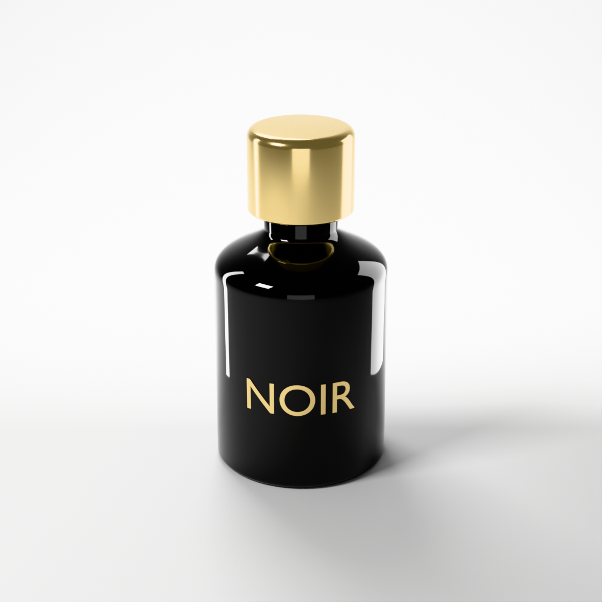
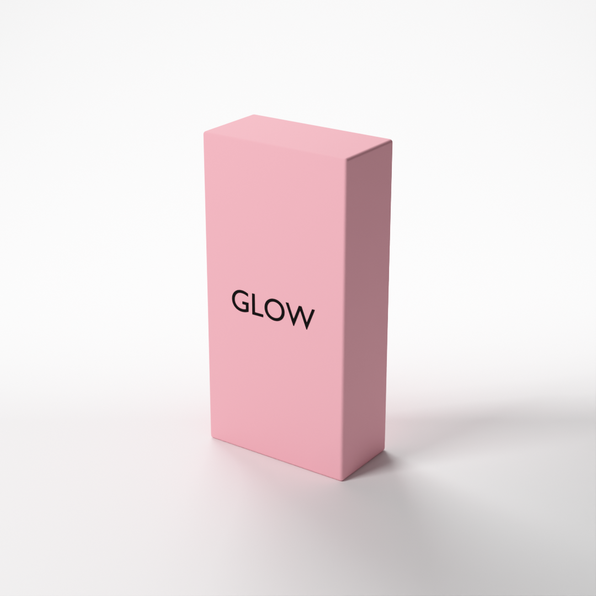
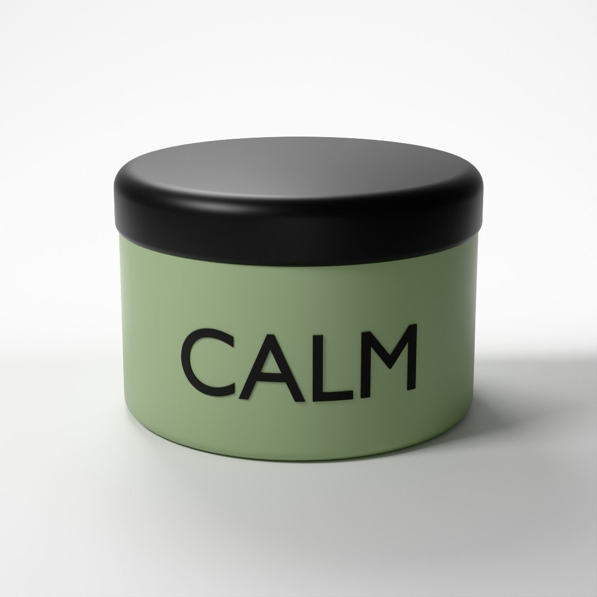
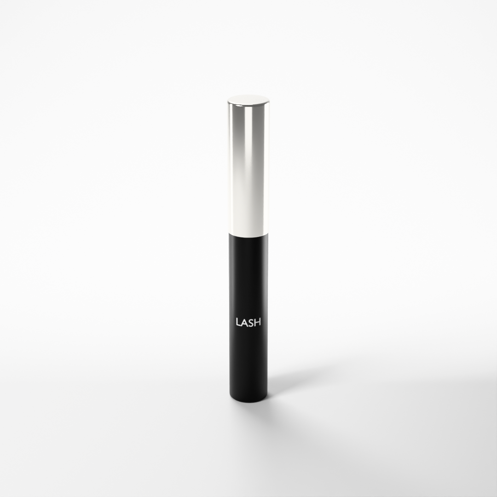
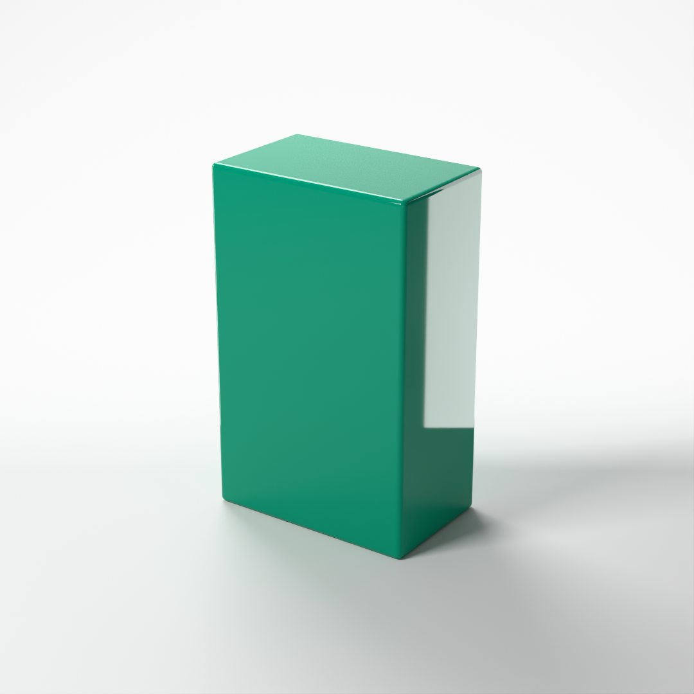
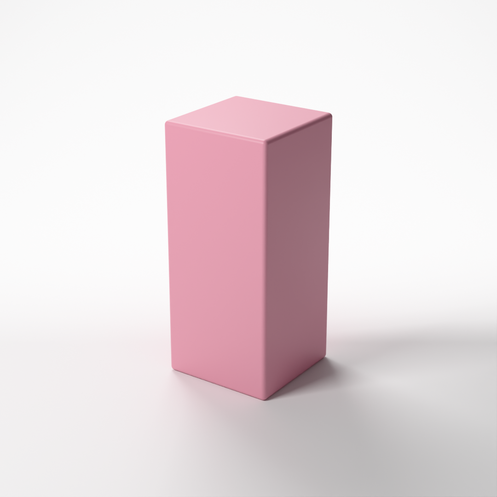
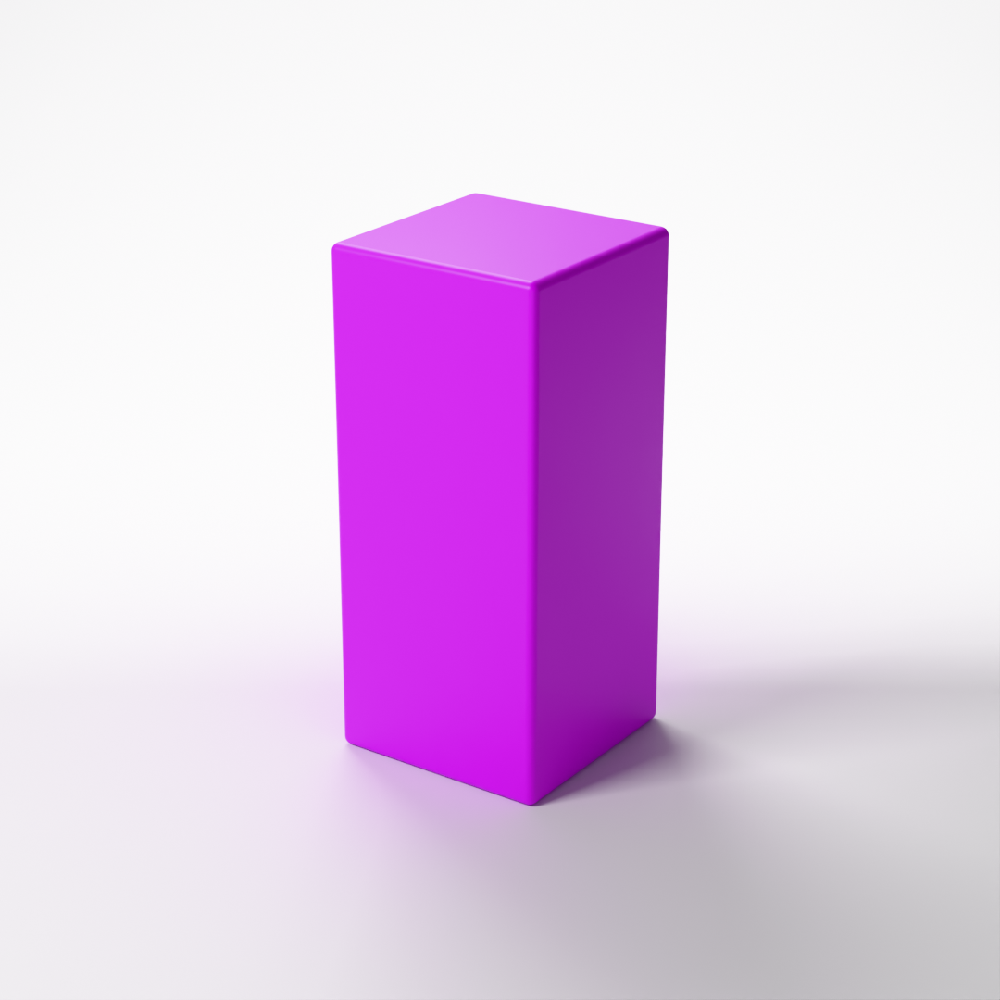

# Prompt-to-Render

[](https://github.com/UditBuilds/prompt-to-render/actions/workflows/tests.yml)

Type a sentence, get a studio product render — fully offline, local 8B model + Blender.

| a glossy black perfume bottle with a gold cap and "NOIR" in gold | a matte pink box with "GLOW" | a sage green face cream jar with "CALM" |
|---|---|---|
|  |  |  |

| a black mascara with a silver cap and "LASH" in white | a glossy emerald perfume box |
|---|---|
|  |  |

No API keys, no cloud calls: the model (`qwen3:8b` via [Ollama](https://ollama.com)) and Blender take turns on one 8 GB laptop GPU.

## How it works

```
sentence → local LLM → spec → validator → code rules → Blender → PNG
           qwen3:8b    JSON   spec.py     backdrops,   Cycles,
           + rows from        (on error,  gloss, metal on the GPU
           small lookup       retry once) caps, labels,
           tables                         size limits
```

The model picks shape, size and colour; code handles rules a small model can't follow reliably (backdrops, gloss, metal, caps, labels, size limits). Text in double quotes is cut out of the sentence before the model sees it, and drawn as the label. Anything the renderer can't draw (glass, pumps, logos) is listed as not rendered, never faked.

## Results

Fixed eval sentences and checks, 3 runs each (`qwen3:8b`, temperature 0.2). The set grew from 37 sentences in v1 to 94 in v2; the first row is the 37 every version ran. What the model chose and what code decided are scored in separate rows.

| | v1 | v1.3 | v2 |
|---|---|---|---|
| What changed | the local model writes the spec | lookup tables; gloss and backdrop set by code; example hex removed from the schema | bottles, jars, cylinders; glossy lighting and metal caps; size limits; quoted-text labels |
| **All checks** | | | |
| The original 37 sentences | 66/111 (59%) | 105/111 (95%) | 105/111 (95%) |
| The 15 shape sentences added in v2 | – | 6/45 (13%) | 45/45 (100%) † |
| All 94 sentences | – | – | 255/282 (90%) † |
| **Chosen by the model** | | | |
| Colour in the lookup table (v1 had none; later versions copy it) | 13/30 | 30/30 | 30/30 |
| Colour in no table: rust, ochre, fuchsia, periwinkle, sapphire | 6/15 | 9/15 | 9/15 |
| Colour in no table: 5 more, added in v2 | – | – | 6/15 |
| Product in no table: right shape and size in the same run | – | – | 3/15 |
| **Decided by code** | | | |
| Metal caps and lids, cylinder caps, jar lid share | – | – | 45/45 |
| Label text, label colour (from quoted text) | – | – | 54/54, 33/33 |

† Includes passes from two fitted fixes, written after their cases failed: a prompt rule keeps a material or dispenser in the product's name on the unsupported list (`unsup_glass`, `unsup_spray`); a code rule draws a squeeze tube as a cylinder (`unsup_squeeze_tube`). Each of those cases scored 0/3 in the run before its fix.

Sources: [`comparison_v1.3.md`](evals/results/comparison_v1.3.md) (v1, v1.3), [`comparison_v2_shapes.md`](evals/results/comparison_v2_shapes.md) (v1.3 on the shape sentences), [`comparison_v2_step4.md`](evals/results/comparison_v2_step4.md) (v2).

## What I learned

- **An example in the schema became the answer.** Asked for fuchsia, the model returned `#E8A3B5` in every v1.2 run: the example hex in the schema. After the example was replaced by `"#RRGGBB"` and stale prompt lines were removed, colours in no table went from 0/15 (v1.2) to 9/15 (v1.3).

  |  |  |
  |---|---|
  | v1.2: the schema's example hex (`#E8A3B5`) | v1.3: the model's own vivid colour (`#E100FF`) |

  Both re-rendered from the saved v1.2 and v1.3 eval specs for "a fuchsia nail polish box"; only the colour differs.

- **Lookup tables raise in-table scores; the out-of-table score is the honest one.** In-table colours went from 13/30 to 30/30, but the model copies the table's hex, so that measures the table. Shapes are the same: products named in the size table or the sentence get the right shape in 141/141 runs (3 of them through the fitted tube rule), while five products in no table get the right shape and size in 3/15.
- **Rules a small model can't follow reliably moved into code.** In all 21 glossy and shiny runs of the final v2 eval, the model wrote a roughness of 0.2–0.3 (glossy needs at most 0.05); code clamps it. Backdrops, metal caps, labels and size limits work the same way: code decides and logs every change; metal, caps and labels are scored in their own rows.
- **HSL was tried, measured and rejected.** Colours written as HSL instead of hex scored better on the 5 new out-of-table colours (9/15 vs 6/15), but reused one default blue (#007FFF) for sapphire (a pass), prussian blue (a fail) and, in one run, even the grey box. It also broke two sentences hex passed (original 37: 105/111 → 102/111) and made each prompt about 1,500 tokens longer (4,828 → 6,323). Hex stayed.
- **Evals were written before the fixes.** From v1.1 on, each version's sentences and checks were committed before its changes, and tuning used a separate dev set. The exceptions are marked: the two fitted fixes above, and the size limits, written after reading the eval's size ranges (no pass depends on one). When a check was corrected, saved runs were re-scored, not re-run.

## Known limitations

- **Unfamiliar colour names.** Sapphire, periwinkle and amethyst fail all 3 runs in the final eval: sapphire comes out CSS indigo (`#4B0082`), amethyst CSS purple (`#800080`), periwinkle a greyish lavender (such as `#B8A9C7`).
- **Products in no table** get the right shape and size in the same run only 3/15 times. An eyebrow pencil and a marker pen come out as bottles; size limits keep shapes plausible but don't choose sizes.
- **Copper and rose gold look alike.** Rose gold's metal colour is an estimate: a paler, pinker copper.
- **No glass or transparency.** Every body is opaque; "glass" is listed as not drawn.
- **Labels are one line, in Blender's built-in font**, up to 20 characters. Image logos aren't drawn; "logo" is listed as not drawn.

## Next

- **Image logos:** a logo file printed on the pack.
- **Glass:** transparent bodies.
- **Multi-line labels.**
- **A larger local model** for colour knowledge (`--model` already takes any Ollama model).

## How to run

Windows 11, PowerShell. Needs Python 3 (standard library only, nothing to `pip install`), [Ollama](https://ollama.com), Blender 5.2 and an NVIDIA RTX GPU (it falls back to the CPU, much slower).

```powershell
ollama pull qwen3:8b                 # once, about 5 GB
python prompt.py "a sage green face cream jar"
python prompt.py 'a black mascara with a silver cap and \"LASH\" in white'
```

Text in double quotes becomes the label. In Windows PowerShell 5.1, write the inner quotes as `\"` as above: without the backslash, PowerShell drops them and no label is drawn.

The image is saved to `runs\<timestamp>_<short-name>\render.png`, with the spec and a full log beside it.

Blender is expected at `C:\Program Files\Blender Foundation\Blender 5.2\blender.exe` (other installed versions are found automatically). If it's elsewhere:

```powershell
$env:BLENDER_PATH = "D:\Apps\Blender\blender.exe"
# or: python prompt.py "a sage green gift box" --blender "D:\Apps\Blender\blender.exe"
```

Tests (offline, no Ollama or Blender): `python -m unittest discover tests`. Evals (needs Ollama; all 94 sentences × 3 runs took about 11 minutes): `python evals/run_evals.py`.

More detail:

- [`docs/details.md`](docs/details.md): the v1 write-up (pipeline, lookup tables, repair loop, evals, renderer).
- v2, step by step, with every case: [shapes](evals/results/comparison_v2_shapes.md), [lighting and metal caps](evals/results/comparison_v2_step2.md), [size limits and the jar](evals/results/comparison_v2_step3.md), [labels](evals/results/comparison_v2_step4.md).
